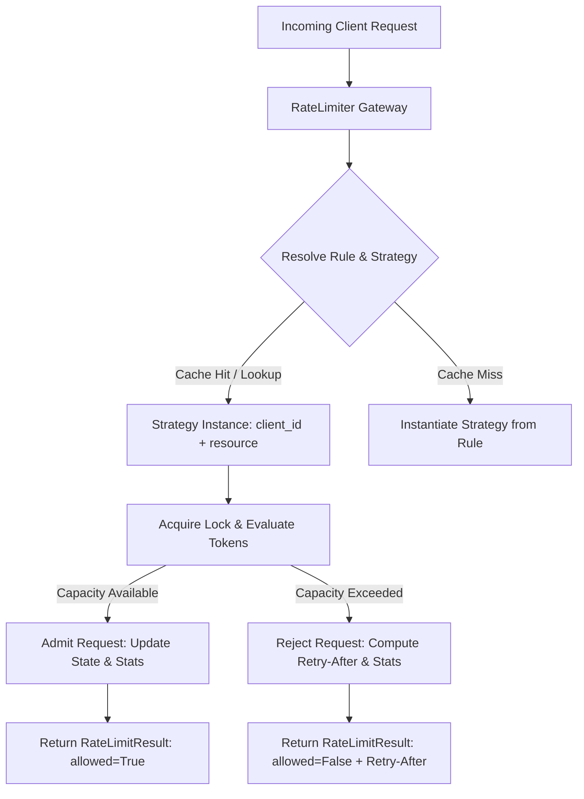

# Project 01: LLM API Gateway Rate Limiter

> **Difficulty:** Easy | **Category:** System Design, Concurrency, API Design | **Target Interview Time:** 45 mins

---

## 🎥 Video Walkthrough & Deep Dive (NotebookLM)

> [!TIP]
> **Conceptual Overview & Architecture Breakdown:**  
> A complete visual and audio deep dive covering multi-tenant rate limiting, sliding window log vs token bucket mechanics, lazy refill arithmetic, and thread safety.
> 
> [](https://drive.google.com/file/d/1csICVtpLVmVxx17R0nxo7n9vIs0XbVHP/view?usp=sharing)
> 
> *Direct Link:* [https://drive.google.com/file/d/1csICVtpLVmVxx17R0nxo7n9vIs0XbVHP/view?usp=sharing](https://drive.google.com/file/d/1csICVtpLVmVxx17R0nxo7n9vIs0XbVHP/view?usp=sharing)

---

## 1. Problem Statement & Context

In a modern AI / LLM gateway architecture (e.g., LiteLLM, Cloudflare AI Gateway, Kong), multiple client applications share scarce downstream LLM inference resources (e.g., token quotas, TPM/RPM limits on OpenAI/Anthropic). 

The rate limiter must:
1. Prevent any single tenant from monopolizing gateway capacity while guaranteeing multi-tenant state isolation.
2. Provide two configurable algorithms:
   - **Sliding Window Log**: For strict non-burst limits (e.g., max 60 requests per minute without window boundary exploits).
   - **Token Bucket**: For burst-tolerant workloads with continuous token replenishment.
3. Compute exact **remaining capacity** and **estimated recovery time (`Retry-After`)** for client backoff.
4. Maintain thread-safe statistics across all requests.
5. Guarantee zero race conditions under high concurrent request volume.

---

## 2. Architecture & Design



### Key Architectural Layers
1. **`models.py`**: Immutable configuration (`RateLimitConfig`), admission response (`RateLimitResult`), and mutable stats (`RateLimiterStats`).
2. **`strategies/`**: 
   - `SlidingWindowStrategy`: Deque of `(timestamp, token_count)` maintaining sliding history.
   - `TokenBucketStrategy`: Continuous mathematical refill based on delta time $\Delta t$.
3. **`limiter.py`**: Central coordinator managing tenant-isolated strategy instances, hierarchical configuration lookup, and defensive copy state delivery.

---

## 3. Step-by-Step Algorithm Walkthrough (With Real Figures)

### 3.1 Sliding Window Log (Exact & Smooth)

#### The Concept
Imagine a moving time window (e.g., 10 seconds). Whenever a request arrives, you record its **exact timestamp**. Before deciding whether to allow a new request, you discard any timestamps older than `current_time - window_size`.

#### Step-by-Step Execution Trace
> **Rule:** Max **3 requests** per **10-second** window.

| Time ($t$) | Action | Timestamps in Window | Status | Explanation |
|---|---|---|:---:|---|
| **$t = 0\text{s}$** | Req 1 arrives | `[0s]` | **Allowed** | 1 of 3 used. |
| **$t = 2\text{s}$** | Req 2 arrives | `[0s, 2s]` | **Allowed** | 2 of 3 used. |
| **$t = 5\text{s}$** | Req 3 arrives | `[0s, 2s, 5s]` | **Allowed** | 3 of 3 used (capacity reached). |
| **$t = 7\text{s}$** | Req 4 arrives | `[0s, 2s, 5s]` | **Rejected** | Window is $[7 - 10 = -3\text{s} \dots 7\text{s}]$. All 3 are still active.<br>**Retry-After:** Req 1 expires at $0 + 10 = 10\text{s}$, so client must wait $10 - 7 = \mathbf{3\text{s}}$. |
| **$t = 11\text{s}$** | Req 5 arrives | `[2s, 5s, 11s]` | **Allowed** | Window is $[1\text{s} \dots 11\text{s}]$. Req 1 (`0s`) is expired and evicted! |

- **Why interviewers like it:** Solves the "boundary burst" exploit of fixed windows (where an attacker sends 3 requests at 00:09 and 3 at 00:11, sneaking 6 requests within 2 seconds).
- **The catch:** Memory grows with traffic because every request timestamp is held in memory in a deque ($O(N)$ space).

---

### 3.2 Token Bucket (Fast & Burst-Friendly)

#### The Concept
Imagine a physical bucket holding tokens:
- **Bucket Capacity ($C$):** Maximum tokens the bucket can hold (e.g., 3 tokens).
- **Refill Rate ($R$):** Tokens continuously dripping in (e.g., 1 token per second).
- A request must consume 1 token to pass. If the bucket is empty, it is rejected.

#### The Coding Trick: "Lazy Refill"
You **never** run a background loop or timer thread adding tokens every second—that destroys CPU performance. 
Instead, when a request arrives, you calculate how many tokens accumulated since the last request:
$$\text{newTokens} = (\text{currentTime} - \text{lastRefillTime}) \times \text{refillRate}$$
$$\text{tokens} = \min(\text{capacity}, \text{tokens} + \text{newTokens})$$

#### Step-by-Step Execution Trace
> **Rule:** Capacity = **3 tokens**, Refill Rate = **1 token/sec**. Starts full with 3 tokens.

| Time ($t$) | Action | Calculation | Bucket Tokens | Status |
|---|---|---|:---:|:---:|
| **$t = 0.0\text{s}$** | **Burst:** 3 requests arrive | 3 tokens requested, 3 available | $3 - 3 = \mathbf{0}$ | **All 3 Allowed** |
| **$t = 0.4\text{s}$** | Req 4 arrives | $\Delta t = 0.4\text{s} \implies +0.4$ tokens. Needs 1 token. | $0.4$ | **Rejected**<br>(Deficit: 0.6 $\to$ retry in 0.6s) |
| **$t = 1.0\text{s}$** | Req 5 arrives | $\Delta t = 0.6\text{s} \implies +0.6$ tokens. Total = $0.4 + 0.6 = 1.0$. | $1.0 - 1 = \mathbf{0}$ | **Allowed** |
| **$t = 10.0\text{s}$** | Idle for 9s | $\Delta t = 9\text{s} \implies +9$ tokens, but capped at capacity (3). | $\mathbf{3}$ (Full) | Ready for next burst |

---

### 3.3 Quick Comparison for Interviews

| Feature | Sliding Window Log | Token Bucket |
|---|---|---|
| **Memory Complexity** | $O(N)$ — stores timestamps of active requests | $O(1)$ — only stores 2 numbers (`tokens`, `timestamp`) |
| **Time Complexity** | $O(K)$ — evicts expired items from deque | $O(1)$ — simple arithmetic |
| **Bursts** | Strictly throttles (no bursts beyond limit) | Allows sudden bursts up to `capacity` |
| **Best Used For** | Strict security/login APIs, expensive database queries | LLM APIs, web traffic, microservice rate limiting |

---

## 4. Concurrency & Thread-Safety Model

1. **Two-Level Locking Hierarchy**:
   - **Master Lock (`self._master_lock`)**: Protects the registry of tenant strategy instances and global statistics counters.
   - **Per-Strategy Lock (`self._lock` inside each strategy instance)**: Protects individual bucket mutations. This prevents requests for `Tenant A` from blocking concurrent requests for `Tenant B`.
2. **Snapshot Isolation & Defensive Copying**:
   - `get_stats()` returns a `copy.deepcopy()` to ensure external callers cannot mutate internal monitoring state.

---

## 5. Complexity Analysis

| Strategy | Time Complexity (Per Request) | Space Complexity |
|---|---|---|
| **Sliding Window** | $O(K)$ where $K$ is number of expired events to evict | $O(N)$ where $N$ is number of requests in current window |
| **Token Bucket** | $O(1)$ constant time arithmetic | $O(1)$ constant state (2 floats) |

---

## 6. Interview Talking Points & Follow-Ups

- **Q: Why Token Bucket over Sliding Window for LLMs?**
  *Answer:* LLMs experience bursty workloads (e.g., generating multiple prompt queries) and token counts vary widely. Token Bucket naturally supports burst capacity up to the bucket ceiling and constant $O(1)$ evaluation time, whereas Sliding Window Log memory grows linearly with request volume.
- **Q: How would you scale this to a distributed cluster?**
  *Answer:* In a distributed system, local in-memory instances lead to inconsistent quota enforcement. We would back this with Redis using Lua scripts for atomicity (e.g., executing token refill and deduction in a single Redis script) or use Redis Cell. To avoid Redis bottlenecks at scale, we can use local batching with periodic asynchronous synchronization.
- **Q: How do you prevent thundering herds when the rate limit window resets?**
  *Answer:* Return randomized jitter alongside `Retry-After` (e.g., Full Jitter or Equal Jitter) so clients do not all retry simultaneously at the exact second of expiration.

---

## 7. Verification & Testing

Execute the full suite of unit and multi-threaded stress tests:

```bash
python -m pytest Proj_01/tests -v
```

Expected output: 12 tests passed covering boundary cases, burst refills, multi-tenant isolation, and concurrent contention.
