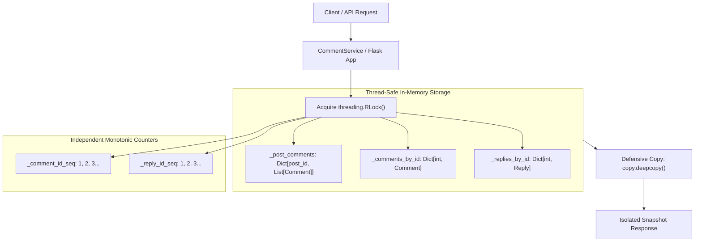

# Project 02: Comments & Replies Discussion Service

> **Difficulty:** Easy | **Category:** Backend, Data Modeling, Concurrency, REST API | **Target Interview Time:** 45 mins

---

## 🎥 Video Walkthrough & Deep Dive (NotebookLM)

> [!TIP]
> **Conceptual Overview & Architecture Breakdown:**  
> A complete visual and audio deep dive covering the two-level discussion hierarchy (Post -> Comment -> Reply), independent auto-incrementing ID sequences, post state isolation, defensive copy snapshot isolation, and reentrant lock thread safety.

<div align="center">

*Video walkthrough link and architectural blueprint thumbnail will be available shortly.*

</div>

---

## 1. Problem Statement & Engineering Context

In production discussion platforms (such as GitHub PR Reviews, YouTube Comments, Instagram, and Reddit), comment systems represent a fundamental systems trade-off between **hierarchical depth** and **query latency**:

```
Arbitrary Recursive N-ary Trees (e.g., HackerNews):
Post ──> Comment ──> Reply ──> Sub-Reply ──> Sub-Sub-Reply ──> ...
(Requires recursive traversal O(N), unbounded UI nesting, complex recursive CTE queries)

Strict Two-Level Hierarchy (e.g., YouTube, Instagram, GitHub PR Reviews):
Post ──> Comment (Level 1) ──> Reply (Level 2 [Terminal Leaf])
(Constant lookup O(1), predictable flat rendering, bounded operational complexity)
```

The **Comments & Replies Discussion Service** implements an in-memory, thread-safe discussion engine strictly constrained to a **two-level discussion topology**:
$$\text{Post} \longrightarrow \text{Comment} \longrightarrow \text{Reply}$$

### Core Requirements
1. **Adding Comments:** Comments belong to a post (`post_id`). Each comment receives an auto-incrementing ID.
2. **Adding Replies:** Replies belong to a parent comment (`comment_id`). Each reply receives an independent auto-incrementing ID.
3. **Strict Two-Level Hierarchy:** Discussions are strictly capped at two levels: `Post -> Comment -> Reply`. Replies cannot have replies; any attempt to reply to a reply is rejected.
4. **Independent Auto-Incrementing IDs:** Comments and replies generate independent sequential integer IDs ($1, 2, 3 \dots$), mirroring relational database tables (`comments.id SERIAL`, `replies.id SERIAL`). Adding a comment does not advance the reply sequence, and adding a reply does not advance the comment sequence.
5. **State Isolation Across Posts:** Comments belonging to distinct posts remain strictly partitioned; no data leakage or cross-post pollution can occur.
6. **Chronological Insertion Order:** Preserves exact creation ordering independently of system clock shifts or timezone adjustments.
7. **Snapshot / Defensive Copy Mutation Safety:** Callers receive isolated deep copies (`copy.deepcopy`). External mutations, list truncations, or field alterations have zero effect on internal service memory.
8. **Input & Type Validation:** Blocks Python's boolean inheritance trap (`isinstance(True, int) is True`), empty strings, whitespace-only strings, and negative IDs.

---

## 2. System Architecture & Memory Model



### Memory Layout & Object References

```
                                      ┌──────────────────────────────────────────────┐
                                      │              CommentService                  │
                                      │  ┌────────────────────────────────────────┐  │
                                      │  │ Reentrant Lock: threading.RLock()      │  │
                                      │  ├───────────────────┬────────────────────┤  │
                                      │  │ _comment_id_seq: 1│ _reply_id_seq: 1   │  │
                                      │  └───────────────────┴────────────────────┘  │
                                      └──────────────────────┬───────────────────────┘
                                                             │
                  ┌──────────────────────────────────────────┴──────────────────────────────────────────┐
                  ▼                                                                                     ▼
     ┌────────────────────────┐                                                            ┌────────────────────────┐
     │   _post_comments Dict  │                                                            │    _comments_by_id     │
     ├────────────────────────┤                                                            ├────────────────────────┤
     │ "post_101" ──► [ C1, C2]│                                                            │ 1 ──► Ref(Comment 1)   │
     │ "post_202" ──► [ C3 ]   │                                                            │ 2 ──► Ref(Comment 2)   │
     └────────────────────────┘                                                            │ 3 ──► Ref(Comment 3)   │
                                                                                           └────────────────────────┘
                                      ┌───────────────────────────────────┐
                                      │         Comment 1 (id=1)          │
                                      ├───────────────────────────────────┤
                                      │ post_id:   "post_101"             │
                                      │ author_id: "user_alice"           │
                                      │ content:   "Concurrency tips?"    │
                                      │ created_at: 1792693800.12         │
                                      │ replies:   [ R1, R2 ]             │
                                      └──────┬─────────────────────┬──────┘
                                             │                     │
                     ┌───────────────────────┴──────┐       ┌──────┴───────────────────────┐
                     ▼                              ▼       ▼                              ▼
     ┌──────────────────────────────┐                       ┌──────────────────────────────┐
     │       Reply 1 (id=1)         │                       │       Reply 2 (id=2)         │
     ├──────────────────────────────┤                       ├──────────────────────────────┤
     │ comment_id: 1                │                       │ comment_id: 1                │
     │ post_id:    "post_101"       │                       │ post_id:    "post_101"       │
     │ author_id:  "user_bob"       │                       │ author_id:  "user_charlie"   │
     │ content:    "Use an RLock!"  │                       │ content:    "Watch deadlocks"│
     │ created_at: 1792693805.45    │                       │ created_at: 1792693810.88    │
     │ add_reply:  RAISES ERROR     │                       │ add_reply:  RAISES ERROR     │
     └──────────────────────────────┘                       └──────────────────────────────┘
```

---

## 3. Discrete Mathematical Hierarchy Formulation

Let the discussion platform state at discrete mutation step $t$ be represented as the 5-tuple:

$$\mathcal{S}_t = \langle \mathcal{P}_t, \mathcal{C}_t, \mathcal{R}_t, \sigma_C, \ \sigma_R \rangle$$

Where:
- $\mathcal{P}_t: \text{PostID} \to \text{Sequence}[\text{Comment}]$ is the mapping from post identifiers to ordered sequences of comments.
- $\mathcal{C}_t: \mathbb{N}^+ \to \text{Comment}$ is the direct hash index of top-level comments by ID.
- $\mathcal{R}_t: \mathbb{N}^+ \to \text{Reply}$ is the direct hash index of leaf replies by ID.
- $\sigma_C \in \mathbb{N}^+$ is the monotonic sequence counter for comment IDs (initialized to $1$).
- $\sigma_R \in \mathbb{N}^+$ is the monotonic sequence counter for reply IDs (initialized to $1$).

### 1. Independent Sequence Invariant
Comment ID generation and reply ID generation operate on completely disjoint sequence registers:

$$\text{id}_{\text{comment}} = \sigma_C, \quad \sigma_C \leftarrow \sigma_C + 1$$
$$\text{id}_{\text{reply}} = \sigma_R, \quad \sigma_R \leftarrow \sigma_R + 1$$

$$\frac{\partial \sigma_C}{\partial (\text{add\_reply})} = 0, \quad \frac{\partial \sigma_R}{\partial (\text{add\_comment})} = 0$$

### 2. Two-Level Tree Depth Bound
Let $G = (V, E)$ be the discussion directed acyclic graph where root nodes are posts:

$$\forall v \in V, \quad \text{depth}(v) \le 2$$
$$\text{depth}(v) = \begin{cases} 0 & \text{if } v \in \text{Posts} \\ 1 & \text{if } v \in \text{Comments} \\ 2 & \text{if } v \in \text{Replies} \end{cases}$$

$$\forall r \in \text{Replies}, \quad \text{deg}^+(r) = 0 \quad (\text{out-degree is strictly zero})$$

$$\text{If } \exists \, \text{edge } (r, u) \text{ where } r \in \text{Replies} \implies \text{VIOLATION} \to \text{Raise } \text{InvalidHierarchyError}$$

### 3. State Isolation Invariant
For any two distinct post identifiers $p_i, p_j$:

$$p_i \ne p_j \implies \mathcal{P}_t[p_i] \cap \mathcal{P}_t[p_j] = \emptyset$$

### 4. Snapshot Defensive Copy Non-Interference
Let $\text{snap} = \text{deepcopy}(\mathcal{C}_t[k])$ be a retrieved snapshot. For any external mutation operator $\mathcal{M}$:

$$\mathcal{M}(\text{snap}) \implies \mathcal{C}_t[k] \equiv \mathcal{C}_t[k]_{(\text{pre-mutation})}$$

$$\Delta(\text{snap}) \not\to \Delta(\mathcal{S}_t)$$

---

## 4. Step-by-Step State Timeline Walkthrough (Real Figures)

Below is an exact chronological execution trace demonstrating multi-post creation, independent counter increments, order preservation, hierarchy violation rejection, and defensive copy snapshot protection:

| Step | Operation Executed | Input Payload | Assigned Entity & ID | `_comment_id_seq` | `_reply_id_seq` | Post Collection State | Explanatory Notes & Invariants |
|:---:|---|---|---|:---:|:---:|---|---|
| **0** | `CommentService()` | *None* | *None* | `1` | `1` | `{}` | Service initialized. Internal dictionaries and lock ready. |
| **1** | `add_comment` | `post_id="post_101"`, `author="alice"`, `content="First post discussion"` | `Comment(id=1)` | `2` | `1` | `{"post_101": [C1]}` | First comment assigned ID `1`. Comment sequence advances to `2`. Reply sequence unchanged at `1`. |
| **2** | `add_comment` | `post_id="post_101"`, `author="bob"`, `content="Second post discussion"` | `Comment(id=2)` | `3` | `1` | `{"post_101": [C1, C2]}` | Second comment assigned ID `2`. Strict FIFO creation order preserved. |
| **3** | `add_reply` | `comment_id=1`, `author="charlie"`, `content="Reply to Alice"` | `Reply(id=1)` | `3` | `2` | `{"post_101": [C1(R1), C2]}` | First reply assigned ID `1` from independent sequence. Comment sequence untouched. |
| **4** | `add_reply` | `comment_id=1`, `author="dave"`, `content="Second reply to Alice"` | `Reply(id=2)` | `3` | `3` | `{"post_101": [C1(R1, R2), C2]}` | Second reply attached to Comment 1. Sequential ID `2` assigned. |
| **5** | `add_comment` | `post_id="post_202"`, `author="eve"`, `content="Topic on post 202"` | `Comment(id=3)` | `4` | `3` | `{"post_101": [C1, C2], "post_202": [C3]}` | **State Isolation:** New post `post_202` created. Comment 3 isolated from `post_101`. |
| **6** | `add_reply` | `comment_id=3`, `author="frank"`, `content="Reply to Eve"` | `Reply(id=3)` | `4` | `4` | `{"post_101": [C1, C2], "post_202": [C3(R3)]}` | Reply 3 assigned to Comment 3 in `post_202`. |
| **7** | `add_reply_to_reply` | `reply_id=1`, `author="malory"`, `content="Illegal sub-reply"` | **REJECTED** | `4` | `4` | *Unchanged* | **Hierarchy Enforcement:** Trapped by `InvalidHierarchyError`. Discussions limited to two levels. |
| **8** | `mutation_attempt` | `c1 = get_comment(1); c1.replies.clear(); c1.content="HACKED"` | **DEFENDED** | `4` | `4` | `{"post_101": [C1(R1, R2), C2], ...}` | **Defensive Copy Invariant:** External mutation altered disconnected deep copy; service state pristine. |

---

## 5. Thread Safety & Concurrency Model

### 1. Synchronization Primitive: `threading.RLock`
The service protects all read-modify-write critical sections using a reentrant lock:

```python
with self._lock:
    comment_id = self._comment_id_seq
    self._comment_id_seq += 1
    ...
```

#### Why Reentrant Lock (`RLock`) over Standard `Lock`?
- **Internal Composition:** High-level service methods (e.g., `get_thread()`) internally delegate to `get_comments_for_post()`, which in turn may check internal caches. An `RLock` permits the owning thread to re-enter nested synchronized methods without self-deadlock.
- **Atomic Sequence Counters:** While a striped or per-post lock structure provides concurrency across independent posts, generating **globally unique auto-incrementing sequential IDs** requires an atomic sequence register. The global `RLock` guarantees atomic ID generation and eliminates complex multi-lock acquisition deadlocks.

### 2. Time & Space Complexity Analysis

| Operation | Method Signature | Time Complexity | Space Complexity | Description |
|---|---|:---:|:---:|---|
| **Add Comment** | `add_comment(post_id, author_id, content)` | $\mathcal{O}(1)$ | $\mathcal{O}(1)$ | Hash lookup + list append + atomic counter increment. |
| **Add Reply** | `add_reply(comment_id, author_id, content)` | $\mathcal{O}(1)$ | $\mathcal{O}(1)$ | Direct comment index lookup + reply list append. |
| **Get Comment** | `get_comment(comment_id)` | $\mathcal{O}(K)$ | $\mathcal{O}(K)$ | $O(1)$ dictionary lookup + deep copy of $K$ nested replies. |
| **Get Post Thread** | `get_comments_for_post(post_id)` | $\mathcal{O}(N \times K)$ | $\mathcal{O}(N \times K)$ | Deep copy of $N$ comments with their respective $K$ replies. |
| **Get Reply** | `get_reply(reply_id)` | $\mathcal{O}(1)$ | $\mathcal{O}(1)$ | Direct reply dictionary lookup + single object copy. |
| **Get Platform Stats** | `get_stats()` | $\mathcal{O}(1)$ | $\mathcal{O}(1)$ | Reading dictionary length properties. |

---

## 6. REST API Specification

The service includes a production-ready Flask REST adapter ([`src/app.py`](./src/app.py)):

| HTTP Method | Route | Request Body | Success Status | Error Codes | Description |
|---|---|---|:---:|:---:|---|
| `POST` | `/api/posts/<post_id>/comments` | `{"author_id": "alice", "content": "Hello"}` | `201 Created` | `400` | Adds a top-level comment to `<post_id>`. |
| `GET` | `/api/posts/<post_id>/comments` | *None* | `200 OK` | `400` | Retrieves all comments with nested replies for `<post_id>`. |
| `POST` | `/api/comments/<comment_id>/replies` | `{"author_id": "bob", "content": "Reply"}` | `201 Created` | `400, 404` | Adds a child reply to `<comment_id>`. |
| `POST` | `/api/replies/<reply_id>/replies` | `{"author_id": "charlie", "content": "..."}` | `400 Bad Request` | `400` | Explicitly rejects attempts to reply to a reply (`InvalidHierarchyError`). |
| `GET` | `/api/comments/<comment_id>` | *None* | `200 OK` | `404` | Retrieves single comment snapshot with replies. |
| `GET` | `/api/comments/<comment_id>/replies` | *None* | `200 OK` | `404` | Retrieves list of replies for `<comment_id>`. |
| `GET` | `/api/stats` | *None* | `200 OK` | — | Retrieves platform-wide metrics (`total_posts`, `total_comments`, `total_replies`). |

---

## 7. Failure Modes & Defensive Mitigations

| Vulnerability / Edge Case | Naive Implementation Failure | Service Defensive Mitigation |
|---|---|---|
| **Python Boolean Trap** | `isinstance(True, int) is True` causes boolean `True` to pass as ID `1`. | Explicitly checks `if isinstance(val, bool): raise ValidationError(...)` before integer checks. |
| **Nested Reply Loophole** | Client calls `add_reply` using a reply's ID, creating illegal level-3 depth. | Model and service enforce leaf terminal checks; `InvalidHierarchyError` raised immediately. |
| **State Leaks Across Posts** | Comments stored in flat list without post partitioning. | Dedicated dictionary partition `_post_comments: Dict[str, List[Comment]]`. |
| **Clock Jitter / Skew** | Relying on `time.time()` for sorting comments breaks if NTP adjusts clock backward. | Strict FIFO append order preserves creation sequence independently of timestamps. |
| **Snapshot Defacement** | Returning internal mutable `list` or `Comment` allows external code to wipe data. | All public queries return `copy.deepcopy()` snapshots; zero shared references exposed. |
| **Whitespace Injections** | Strings containing `"   "` or `"\t\n"` pollute database with empty comments. | Mandatory `_validate_non_empty_string()` strips whitespace and validates length $> 0$. |

---

## 8. Test Suite Directory Structure

```
Proj_02/
├── 02.png                          # Original LeetCode problem specification capture
├── README.md                       # Comprehensive architectural blueprint & walkthrough
├── src/
│   ├── __init__.py                 # Package exports and domain interface
│   ├── app.py                      # Flask REST API adapter with standard error handlers
│   ├── exceptions.py               # Custom domain exceptions (ValidationError, InvalidHierarchyError, etc.)
│   ├── models.py                   # Comment and Reply dataclasses with defensive copy helpers
│   └── service.py                  # Thread-safe in-memory discussion engine with RLock
└── tests/
    ├── conftest.py                 # Pytest fixtures for isolated service & Flask client instances
    ├── test_comment_lifecycle.py   # Creation order, multi-post isolation, independent sequences
    ├── test_concurrency.py         # 25-thread parallel stress tests & mixed traffic race conditions
    ├── test_defensive_copies.py    # Mutation resistance tests verifying pristine memory state
    ├── test_flask_api.py           # End-to-end HTTP REST endpoint and status code verification
    └── test_input_validation.py    # Strict type safety, boolean trap prevention, whitespace checks
```

---

## 9. Verification & Running Tests

Run the full automated test suite for Project 02:

```bash
# Execute Proj_02 test suite (30 passing tests)
python -m pytest Proj_02/tests -v

# Execute entire workspace suite (173 passing tests)
python -m pytest -v
```
