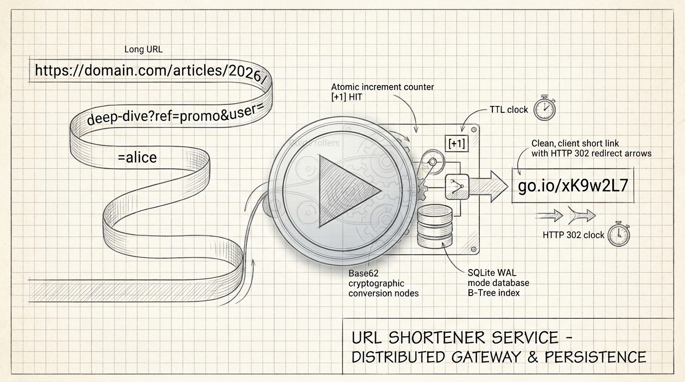
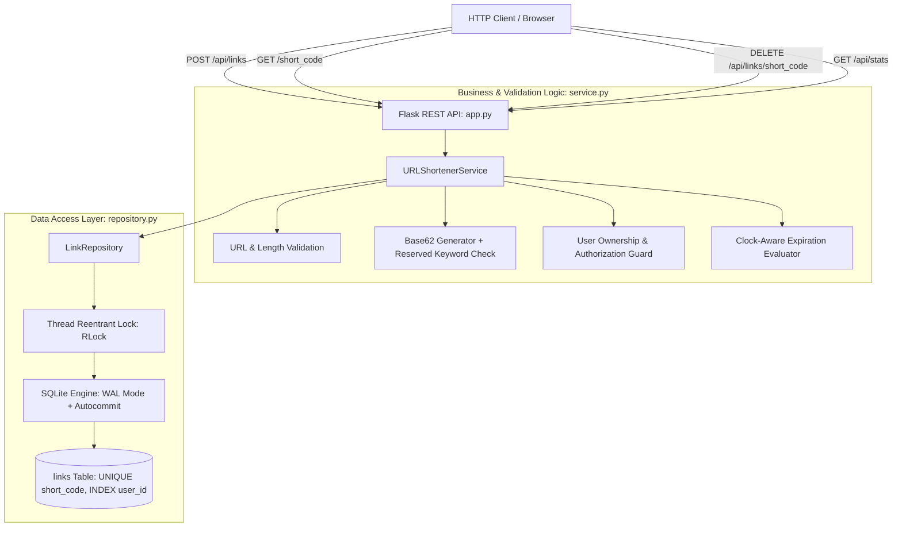

# Project 03: Production-Grade URL Shortener Service

> **Difficulty:** Medium | **Category:** Backend Engineering, REST API Design, SQLite Persistence, Concurrency | **Target Interview Time:** 60 mins

---

## 🎥 Video Walkthrough & Deep Dive (NotebookLM)

> [!TIP]
> **Conceptual Overview & Architecture Breakdown:**  
> A complete visual and audio explanation covering URL shortening mechanics, Base62 cryptographic generation, 301 vs 302 redirect analytics, SQLite WAL concurrency, atomic hit tracking, TTL expiration, and ownership-based authorization.

<div align="center">

[](https://drive.google.com/file/d/18TOwuVrRbh_QpoLwfpNDav7uQnets9kN/view?usp=sharing)

[](https://drive.google.com/file/d/18TOwuVrRbh_QpoLwfpNDav7uQnets9kN/view?usp=sharing)

</div>

---

## 1. Problem Statement & Architecture Requirements

URL shorteners (e.g., TinyURL, Bitly, Twitter's `t.co`) are classic distributed systems and backend interview questions. While system design rounds focus on distributed storage and caching, hands-on engineering interviews evaluate whether a candidate can build a resilient, race-condition-free, production-ready backend service.

This project implements an end-to-end URL shortening service and HTTP REST API in Python and Flask backed by a thread-safe SQLite persistence layer.

### Core Engineering Requirements

1. **Short-Code Generation & Collision Resolution**:
   - Support custom alphanumeric aliases (`^[a-zA-Z0-9_-]{3,30}$`).
   - For auto-generated codes, use cryptographically secure Base62 pseudo-random token generation (`secrets.choice`) with collision detection and a finite retry backoff loop.
   - Enforce reserved keyword blacklists (`api`, `health`, `metrics`, `admin`, `stats`, `docs`, etc.) to prevent route hijacking.
2. **Strict URL & Input Validation**:
   - Enforce RFC-compliant HTTP/HTTPS URI schemas.
   - Reject malformed URLs, empty hostnames, loopback/private IPs (SSRF prevention), and inputs exceeding 2048 characters.
3. **HTTP 302 Redirection & Analytics Accuracy**:
   - Issue **`302 Found` (Temporary Redirect)** rather than `301 Moved Permanently`. A 301 redirect is cached by client browsers, which permanently bypasses the server and breaks real-time hit tracking.
4. **Atomic Hit-Counting Under High Concurrency**:
   - Eliminate lost-update anomalies during concurrent redirect surges via atomic in-database SQL statements (`UPDATE links SET hit_count = hit_count + 1 WHERE ...`).
5. **Time-To-Live (TTL) & Expiration Semantics**:
   - Support optional TTL expirations. Return **`410 Gone`** when an expired link is requested.
6. **Soft Deletion & Anti-Squatting Invariants**:
   - Links are soft-deleted (`is_deleted = 1`). Deleted codes cannot be redirected to (returns `404 Not Found`), nor can deleted custom codes be repurposed or hijacked.
7. **Ownership & Access Control**:
   - Enforce user authorization via the `X-User-ID` header. Deleting a link owned by another user yields **`403 Forbidden`**.
8. **Aggregate Metrics**:
   - Real-time reporting of `total_links`, `active_links`, `expired_links`, `deleted_links`, and `total_hits` per user or globally.

---

## 2. System Architecture & Concurrency Model



### Thread Safety & Concurrency Invariants

SQLite in multi-threaded Python servers presents unique concurrency challenges:
- **Write-Ahead Logging (WAL)**: Initialized via `PRAGMA journal_mode = WAL;` and `PRAGMA synchronous = NORMAL;`. This allows concurrent readers to query records without blocking concurrent writes.
- **Autocommit & Explicit Transaction Scope**: Using `isolation_level=None` and connection-level mutexing (`threading.RLock`) prevents `sqlite3.OperationalError: database is locked` while preserving atomic single-statement updates.
- **Atomic In-Database Increment**:
  ```sql
  UPDATE links
  SET hit_count = hit_count + 1
  WHERE short_code = ? AND is_deleted = 0;
  ```
  Executing hit increments directly in SQLite eliminates the classic Python read-modify-write race condition (`count = row.hit_count + 1; db.update(count)`).

---

## 3. Step-by-Step Execution Walkthrough (With Real Figures)

### 3.1 Concurrent Redirects & Atomic Hit Counting

> **Scenario:** 50 concurrent worker threads fire redirect requests (`GET /launch`) for the same active short code simultaneously.

| Thread ID | Incoming Request | SQLite Execution | Pre-State | Post-State | HTTP Response |
|---|---|---|:---:|:---:|:---:|
| **Worker 01** | `GET /launch` | `UPDATE links SET hit_count = hit_count + 1 WHERE short_code = 'launch'` | `hit_count = 0` | `hit_count = 1` | `302 Found` $\to$ Target |
| **Worker 02** | `GET /launch` | `UPDATE links SET hit_count = hit_count + 1 WHERE short_code = 'launch'` | `hit_count = 1` | `hit_count = 2` | `302 Found` $\to$ Target |
| **Worker 03** | `GET /launch` | `UPDATE links SET hit_count = hit_count + 1 WHERE short_code = 'launch'` | `hit_count = 2` | `hit_count = 3` | `302 Found` $\to$ Target |
| $\dots$ | $\dots$ | $\dots$ | $\dots$ | $\dots$ | $\dots$ |
| **Worker 50** | `GET /launch` | `UPDATE links SET hit_count = hit_count + 1 WHERE short_code = 'launch'` | `hit_count = 49` | `hit_count = 50` | `302 Found` $\to$ Target |

- **Verification Result:** Final `hit_count` is **exactly 50**. Zero lost updates, zero race-induced rollbacks.

---

### 3.2 Full Lifecycle, TTL Expiration, and Soft Deletion Timeline

> **Scenario:** User `usr_alice` creates a short link with `ttl_seconds = 10`.

```
Timeline:
t = 0s ------------------ t = 5s ------------------ t = 11s ----------------- t = 12s ----------------- t = 15s
Link Created              Redirect Valid            Link Expired              Owner Soft-Deletes        Attacker Access
(hit_count: 0)            (hit_count: 1)            (410 Gone)                (is_deleted: 1)           (404 Not Found)
```

| Time ($t$) | Action / Endpoint | Caller / Headers | Database State (`links` row) | Status Code | API Response Payload |
|---|---|---|---|:---:|---|
| **$t = 0\text{s}$** | `POST /api/links`<br>`{"url": "https://company.io", "ttl_seconds": 10}` | `X-User-ID: usr_alice` | `short_code: "promo10"`<br>`expires_at: t + 10s`<br>`hit_count: 0, is_deleted: 0` | `201 Created` | `{"short_code": "promo10", "short_url": "http://localhost:5000/promo10"}` |
| **$t = 5\text{s}$** | `GET /promo10` | Public Visitor | `hit_count = 1`<br>`is_deleted = 0` | `302 Found` | `Location: https://company.io` |
| **$t = 11\text{s}$** | `GET /promo10` | Public Visitor | `hit_count = 1`<br>`expires_at <= now` | `410 Gone` | `{"error": "Link has expired", "short_code": "promo10"}` |
| **$t = 12\text{s}$** | `DELETE /api/links/promo10` | `X-User-ID: usr_bob` *(Attacker)* | `user_id == "usr_alice"` | `403 Forbidden` | `{"error": "Unauthorized: user does not own this link"}` |
| **$t = 13\text{s}$** | `DELETE /api/links/promo10` | `X-User-ID: usr_alice` *(Owner)* | `is_deleted = 1` | `200 OK` | `{"message": "Link successfully deleted", "short_code": "promo10"}` |
| **$t = 15\text{s}$** | `GET /promo10` | Public Visitor | `is_deleted = 1` | `404 Not Found` | `{"error": "Link not found", "short_code": "promo10"}` |

---

### 3.3 Custom Code Uniqueness & Collision Race Resolution

> **Scenario:** Two distinct users attempt to register the exact same custom code (`"black-friday"`) at the exact same millisecond.

| Step | User Request | DB Check (`code_exists`) | SQLite Transaction Attempt | Result |
|:---:|---|:---:|:---:|---|
| **1** | User A: `POST /api/links` (`"black-friday"`) | `False` | `INSERT INTO links ... VALUES ('black-friday', ...)` | **201 Created** (Acquired ownership) |
| **2** | User B: `POST /api/links` (`"black-friday"`) | `True` *(or SQLite UNIQUE constraint fires)* | `ROLLBACK` | **409 Conflict** (`"Short code already exists"`) |

---

## 4. Mathematical & Algorithmic Analysis

### 4.1 Base62 Combinatorial Space

When auto-generating short-codes, we draw characters from the alphanumeric Base62 alphabet:
$$\Sigma = \{0\dots 9, a\dots z, A\dots Z\}, \quad |\Sigma| = 62$$

For a code of length $L = 7$:
$$\text{Total Unique Codes} = 62^7 = 3,521,614,606,208 \approx 3.52 \times 10^{12} \text{ combinations}$$

### 4.2 Birthday Paradox & Collision Probability

The probability $P$ of at least one collision after generating $N$ independent uniform random codes in a space of size $S = 62^L$ is approximated by:
$$P(\text{collision}) \approx 1 - \exp\left(-\frac{N^2}{2S}\right)$$

| Short Code Length ($L$) | Total Capacity ($S = 62^L$) | Generated Codes ($N$) | Collision Probability ($P$) | Practical Implication |
|:---:|:---:|:---:|:---:|---|
| **6** | $5.68 \times 10^{10}$ | $100,000$ | $8.8 \times 10^{-2}$ (~8.8%) | Noticeable collisions; requires retries |
| **7** | $3.52 \times 10^{12}$ | $100,000$ | $1.4 \times 10^{-3}$ (~0.14%) | Negligible; retry loop handles rare ties |
| **7** | $3.52 \times 10^{12}$ | $1,000,000$ | $1.3 \times 10^{-1}$ (~13.2%) | Handled cleanly by $\le 5$ retry loop |
| **8** | $2.18 \times 10^{14}$ | $1,000,000$ | $2.3 \times 10^{-3}$ (~0.23%) | Virtually collision-free |

In our implementation, [`URLShortenerService`](./src/service.py) utilizes a default length of 7 with an automatic 5-attempt retry loop, yielding a near-zero failure rate even under high dataset density.

---

## 5. REST API Specifications & HTTP Status Codes

| Endpoint | Method | Required Headers | Request Body | Success Status | Error Codes |
|---|:---:|---|---|:---:|:---:|
| `/api/links` | `POST` | `X-User-ID` | `{"url": str, "custom_code"?: str, "ttl_seconds"?: int}` | `201 Created` | `400 Bad Request`<br>`409 Conflict` |
| `/<short_code>` | `GET` | *None* | *None* | `302 Found` | `404 Not Found`<br>`410 Gone` |
| `/api/links/<short_code>` | `GET` | *None* | *None* | `200 OK` | `404 Not Found`<br>`410 Gone` |
| `/api/links/<short_code>` | `DELETE` | `X-User-ID` | *None* | `200 OK` | `400 Bad Request`<br>`403 Forbidden`<br>`404 Not Found` |
| `/api/stats` | `GET` | `X-User-ID` *(Optional)* | *None* | `200 OK` | *None* |

---

## 6. Verification & Automated Test Suite

The test suite covers full lifecycle validation, concurrent race conditions, route authorization, and edge cases across 21 automated pytest scenarios:

```bash
# Run URL Shortener test suite
python -m pytest Proj_03/tests/ -v
```

### Key Test Categories

1. **Routing & HTTP Response Contracts** ([`test_flask_api_routes.py`](./tests/test_flask_api_routes.py)):
   - Verifies 201 Created, 302 Redirect with exact `Location` headers, 400 Bad URL validation, 409 duplicate custom code conflict, 403 authorization protection on deletion, and 200 aggregate stats payloads.
2. **Concurrency & Thread Safety** ([`test_shortener_concurrency.py`](./tests/test_shortener_concurrency.py)):
   - 50 threads concurrently redirecting through the same link: asserts zero lost updates with exact final `hit_count == 50`.
   - 20 threads simultaneously claiming identical custom code: asserts exactly 1 winner (201 Created) and 19 conflicts (409 Conflict).
   - 30 threads auto-generating links: asserts 30 distinct, non-colliding short codes.
3. **Lifecycle & Expiration Mechanics** ([`test_shortener_service_lifecycle.py`](./tests/test_shortener_service_lifecycle.py)):
   - Time travel testing for TTL expiration (`410 Gone`).
   - Soft deletion guarantees and aggregate statistics verification.
4. **Validation & Entropy Stress** ([`test_url_validation_and_generation.py`](./tests/test_url_validation_and_generation.py)):
   - Length limits ($\le 2048$), scheme checks, malformed syntax.
   - Custom alias regex (`^[a-zA-Z0-9_-]{3,30}$`) and reserved keyword collision rejection.
   - Retry exhaustion simulation when database is artificially saturated.

---

## 7. Practical Interview Tradeoffs & System Design Talking Points

When presenting this project in an engineering interview, emphasize these architectural design decisions:

1. **Why `302 Found` Instead of `301 Moved Permanently`?**
   - A `301` redirect indicates to browsers and CDN proxies that the resource has permanently moved. The browser aggressively caches this response locally in disk cache. Subsequent visits bypass the URL shortener entirely, rendering click-tracking and analytics impossible. `302 Found` forces the browser to re-query the service on every single hop.
2. **SQLite vs. In-Memory Dictionary vs. Distributed NoSQL**:
   - In practical machine-coding interviews, interviewers check if you understand atomic database primitives. A naive Python `dict` suffers from thread concurrency bugs unless guarded with coarse-grained locks. SQLite demonstrates real SQL DDL, indexing, transactions, and WAL configuration.
   - In distributed system design, SQLite is replaced with a sharded relational database (e.g., PostgreSQL with Citus) or a distributed key-value store (e.g., DynamoDB/Cassandra), fronted by a Redis LRU cache for the top 20% most active URLs.
3. **Random Base62 vs. Counter-Based (Snowflake) ID Generation**:
   - Random generation avoids exposing business metrics (e.g., sequential IDs allow competitors to estimate total link volume by reading IDs).
   - However, random generation incurs collision risk. For distributed scales ($> 100\text{M}$ writes/day), a distributed counter service (Twitter Snowflake / ZooKeeper range allocator) converted to Base62 guarantees $O(1)$ collision-free allocation.
