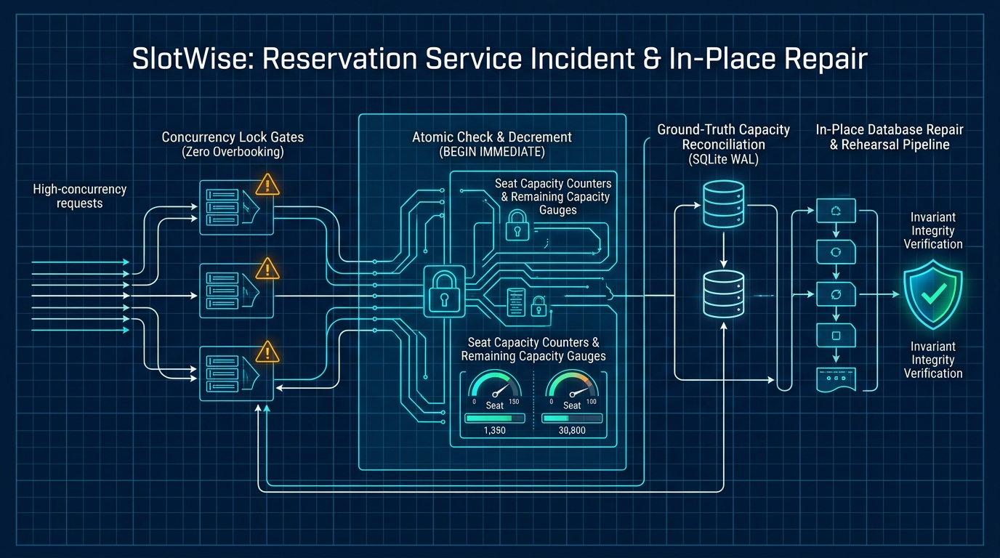
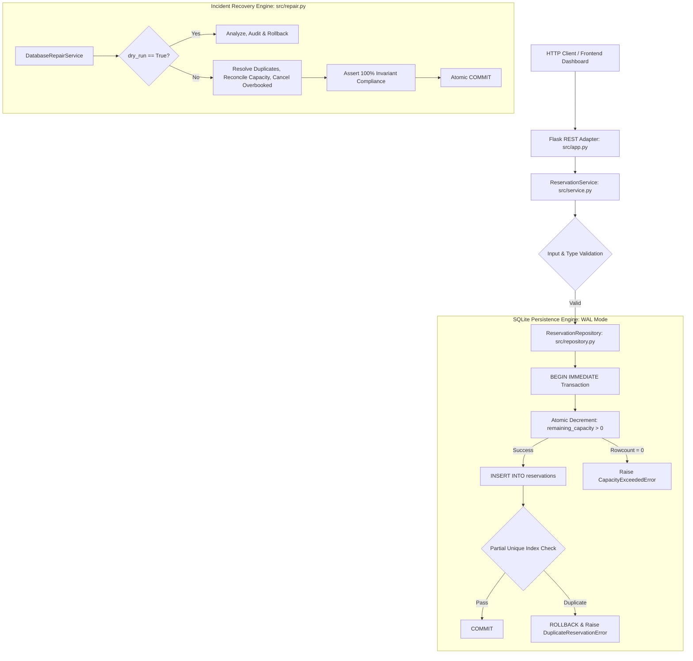
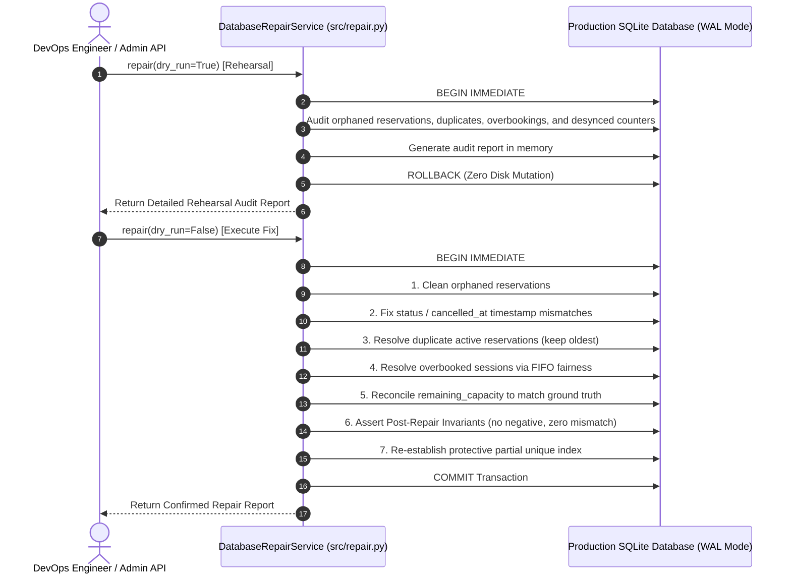

# Project 04: SlotWise — Reservation Service Incident & In-Place Repair

> **Difficulty:** Medium | **Category:** Production Debugging, Concurrency, SQLite Persistence, Database Repair | **Target Interview Time:** 60 mins

---

## 🎥 Video Walkthrough & Deep Dive (NotebookLM)

> [!TIP]
> **Conceptual Overview & Architecture Breakdown:**  
> A complete visual and audio deep dive covering the SlotWise incident post-mortem: diagnosing race condition overbooking, atomic check-and-decrement SQL, ground-truth capacity reconciliation, authorization-enforced cancellations, and transactional in-place historical database repair with dry-run rehearsals.

<div align="center">

[](https://drive.google.com/file/d/1AB4pEInBqioXpBjXLIoCPz_N4sURLbst/view?usp=sharing)

[](https://drive.google.com/file/d/1AB4pEInBqioXpBjXLIoCPz_N4sURLbst/view?usp=sharing)

</div>

---

## 1. Problem Statement & Engineering Context

**SlotWise** is an event and online course reservation platform where users browse upcoming sessions, check remaining seat capacity, make or cancel bookings, and view their active reservations on a dashboard.

Following a major promotional campaign, customer support reported widespread service degradation:
1. **Overbooking Race Conditions:** Multiple users reserving simultaneously when remaining capacity is low ($1$ seat remaining) both receive confirmation. The session's remaining capacity drops to negative numbers or exceeds the room limit.
2. **Conflicting Capacity Numbers:** Different parts of the product report contradictory seat availability. The course catalog displays $5$ seats remaining, while the booking checkout reports $0$, or vice versa.
3. **Cancellation State Anomalies:** Repeatedly clicking "Cancel" restores seat capacity multiple times (double-cancellation inflation), and users can cancel reservations belonging to other attendees without authorization.
4. **Corrupted Production Database State:** Historical database records already contain overbooked sessions, desynchronized counter columns, orphaned reservations, and duplicate active bookings. Because this is a live production database with active user accounts, **it cannot be dropped or reset**—it must be audited and repaired in place with absolute zero data loss.

This project delivers a robust, ACID-compliant backend architecture and an automated, transactional database repair engine that permanently resolves the incident and re-establishes mathematical invariants.

---

## 2. System Architecture & Concurrency Model

### 2.1 Layered Architectural Diagram



### 2.2 Root Causes & Engineering Remedies

| Incident Symptom | Naive Architecture Failure | SlotWise Fixed Architecture |
|---|---|---|
| **Overbooking Under Concurrency** | Application reads `remaining_capacity` in Python memory, checks `> 0`, then executes `UPDATE`. Interleaved threads all read `1`, all book, resulting in overbooking. | Uses atomic conditional SQL update: `UPDATE sessions SET remaining_capacity = remaining_capacity - 1 WHERE session_id = ? AND remaining_capacity > 0;`. If `rowcount == 0`, immediately rolls back. |
| **Conflicting Capacity Displays** | Read-side endpoints read the denormalized `sessions.remaining_capacity` column, which drifts from actual active reservation counts. | Implements unified capacity calculation: ground truth is defined by `total_capacity - COUNT(active reservations)`. The denormalized column is synchronized within the same atomic transaction. |
| **Double Cancellation Inflation** | Calling cancel repeatedly executes `UPDATE sessions SET remaining_capacity = remaining_capacity + 1` without verifying current reservation status. | Restores capacity **if and only if** the reservation status transition `ACTIVE -> CANCELLED` succeeds (`rowcount == 1`). Subsequent cancellation attempts raise `AlreadyCancelledError`. |
| **Unauthorized Cancellations** | Cancel endpoint only takes `reservation_id`, allowing any caller to cancel any user's seat. | Enforces strict ownership: requires `user_id`, checks `reservation.user_id == user_id`, raising `UnauthorizedCancellationError` on mismatch. |
| **Duplicate Active Bookings** | Users double-clicking "Reserve" receive two active seats for the same session. | Enforces database-level partial unique index: `CREATE UNIQUE INDEX idx_active_user_session ON reservations(session_id, user_id) WHERE status = 'ACTIVE'`. |

---

## 3. Discrete Mathematical Modeling & Invariants

Let the system state $\mathcal{S}$ at any discrete time $t$ be defined by the tuple:

$$
\mathcal{S}_t = \langle \mathcal{U}, \mathcal{C}, \mathcal{R}_t \rangle
$$

Where $\mathcal{U}$ is the universe of users, $\mathcal{C}$ is the set of sessions, and $\mathcal{R}_t$ is the set of all reservations.

### 3.1 Ground-Truth Capacity Conservation Law
For each session $s \in \mathcal{C}$ with total capacity $T(s) \in \mathbb{Z}^+$ and remaining capacity $C_{\text{rem}}(s, t) \in \mathbb{Z}_{\ge 0}$:

Let the active reservation set $\mathcal{A}(s, t)$ be defined as:

$$
\mathcal{A}(s, t) = \{ r \in \mathcal{R}_t \mid r.\text{session-id} = s \land r.\text{status} = \text{ACTIVE} \}
$$

The fundamental conservation invariant states that at all times $t$:

$$
C_{\text{rem}}(s, t) = T(s) - |\mathcal{A}(s, t)|
$$

$$
0 \le C_{\text{rem}}(s, t) \le T(s)
$$

$$
|\mathcal{A}(s, t)| \le T(s)
$$

### 3.2 Single-Winner Concurrency Under Contention
Suppose $K$ concurrent threads submit reservation requests for session $s$ at time $t$, where current remaining capacity is $C_{\text{rem}}(s, t)$. The state transition satisfies:

$$
\Delta |\mathcal{A}(s)| = \min(K, C_{\text{rem}}(s, t))
$$

$$
\text{Successful Admissions} = \min(K, C_{\text{rem}}(s, t))
$$

$$
\text{Rejected Requests} = \max(0, K - C_{\text{rem}}(s, t))
$$

Zero race conditions can produce $|\mathcal{A}(s, t+1)| > T(s)$.

### 3.3 Historical Overbooking Resolution (FIFO Fairness)
When repairing an overbooked legacy session $s$ where $|\mathcal{A}(s)| > T(s)$, the repair engine partitions active bookings chronologically by creation timestamp:

$$
\mathcal{A}_{\text{confirmed}}(s) = \text{Earliest}_{T(s)}(\mathcal{A}(s))
$$

$$
\mathcal{A}_{\text{excess}}(s) = \mathcal{A}(s) \setminus \mathcal{A}_{\text{confirmed}}(s)
$$

The state transition applies:

$$
\forall r \in \mathcal{A}_{\text{confirmed}}(s), \quad r.\text{status} \leftarrow \text{ACTIVE}
$$

$$
\forall r \in \mathcal{A}_{\text{excess}}(s), \quad r.\text{status} \leftarrow \text{CANCELLED}, \quad r.\text{cancelled-at} \leftarrow t_{\text{repair}}
$$

$$
C_{\text{rem}}(s) \leftarrow 0
$$

This guarantees fair FIFO preservation: users who booked earliest retain their seats, while excess reservations are cleanly resolved with audit records.

---

## 4. Step-by-Step Chronological Walkthrough (Real Figures)

Below is an exact trace of system events demonstrating session creation, concurrent booking races, cancellation authorization, and in-place database repair:

| Step | Operation | Parameters / Inputs | Evaluated Decision Path | Resulting State | Status Code / Invariant |
|:---:|---|---|---|:---:|:---:|
| **0** | `create_session` | `title="Distributed Systems"`, `capacity=2` | Input validated; session initialized | `total=2`, `rem=2`, `active=0` | **201 Created** |
| **1** | `make_reservation` | `session_id="s1"`, `user_id="alice"` | Atomic decrement succeeds ($2 \to 1$); reservation record inserted | `rem=1`, `active=1` (Alice) | **201 Created** |
| **2** | `make_reservation` | `session_id="s1"`, `user_id="alice"` (Duplicate) | Unique index intercept: Alice already holds active booking | State unchanged | **409 Conflict** (`DUPLICATE_RESERVATION`) |
| **3** | `concurrency_race` | 10 parallel threads competing for last 1 seat | Thread 3 acquires atomic decrement ($1 \to 0$); Threads 1-2, 4-10 receive `rowcount = 0` | `rem=0`, `active=2` | Exactly **1 Winner** (201), **9 Rejected** (409) |
| **4** | `cancel_reservation` | Alice's reservation, caller `user_id="mallory"` | Ownership check: `reservation.user_id != "mallory"` | State unchanged | **403 Forbidden** (`UNAUTHORIZED_CANCELLATION`) |
| **5** | `cancel_reservation` | Alice's reservation, caller `user_id="alice"` | Ownership verified; status `ACTIVE -> CANCELLED`; capacity incremented ($0 \to 1$) | `rem=1`, `active=1` | **200 OK** |
| **6** | `cancel_reservation` | Alice's reservation, caller `user_id="alice"` (Re-cancel) | Status check: reservation is already `CANCELLED` | Capacity **NOT** incremented | **409 Conflict** (`ALREADY_CANCELLED`) |
| **7** | `corrupt_db_inject` | Legacy overbooking simulation | 4 active bookings injected for capacity 2 session; remaining set to false `999` | Corrupted production state | Capacity desynchronized |
| **8** | `admin_repair` | `dry_run=True` (Production Rehearsal) | Audits all sessions; identifies 1 overbooked, 1 desynced capacity; rolls back | No data modified | **200 OK** (Rehearsal Report generated) |
| **9** | `admin_repair` | `dry_run=False` (In-Place Fix) | Cancels 2 excess bookings by FIFO; resets remaining capacity to 0; asserts invariants | `rem=0`, `active=2`, `cancelled=2` | **200 OK** (Permanent Fix Committed) |
| **10** | `get_capacity` | `session_id="s1"` | Ground truth evaluation: $2 - 2 = 0$ | `is_consistent=True` | **100% Invariant Compliance** |

---

## 5. Production In-Place Database Repair Architecture

When fixing a live production database with active customers, destroying the database or dropping tables is strictly forbidden. The repair engine operates under three ironclad operational constraints:



---

## 6. REST API Specification

The service exposes a production-ready Flask REST interface ([`src/app.py`](./src/app.py)):

| HTTP Method | Route | Request Body | Success Code | Error Codes | Description |
|---|---|---|:---:|:---:|---|
| `POST` | `/api/sessions` | `{"title": "...", "total_capacity": 10, "start_time": "...", "end_time": "..."}` | `201 Created` | `400 Bad Request` | Creates a new course or event session. |
| `GET` | `/api/sessions` | *None* | `200 OK` | — | Lists upcoming sessions sorted chronologically. |
| `GET` | `/api/sessions/<id>` | *None* | `200 OK` | `404 Not Found` | Retrieves session configuration and remaining seats. |
| `GET` | `/api/sessions/<id>/capacity` | *None* | `200 OK` | `404 Not Found` | Ground-truth capacity reconciliation report. |
| `POST` | `/api/sessions/<id>/reserve` | `{"user_id": "u1"}` | `201 Created` | `400, 404, 409` | Atomically reserves a seat for user. |
| `POST` | `/api/reservations/<id>/cancel`| `{"user_id": "u1"}` | `200 OK` | `400, 403, 404, 409`| Cancels reservation with ownership verification. |
| `GET` | `/api/reservations/<id>` | *None* | `200 OK` | `404 Not Found` | Retrieves reservation metadata and status. |
| `GET` | `/api/users/<id>/reservations` | *None* | `200 OK` | — | Lists user reservation history (most recent first). |
| `POST` | `/api/admin/repair` | `{"dry_run": false}` | `200 OK` | `500 Server Error` | Executes in-place database audit and repair. |

---

## 7. Complexity Analysis

| Operation | Method Signature | Time Complexity | Disk I/O | Space Complexity |
|---|---|:---:|:---:|:---:|
| **Create Session** | `create_session(...)` | $O(1)$ | 1 sequential write | $O(1)$ |
| **Get Session** | `get_session(id)` | $O(1)$ | Index lookup | $O(1)$ |
| **List Sessions** | `list_sessions()` | $O(N \log N)$ | Sequential scan | $O(N)$ |
| **Make Reservation** | `make_reservation(...)` | $O(1)$ | 1 atomic update + 1 insert | $O(1)$ |
| **Cancel Reservation** | `cancel_reservation(...)` | $O(1)$ | 1 update + 1 capacity restore | $O(1)$ |
| **Capacity Report** | `get_session_capacity(...)` | $O(R)$ | Index aggregate query | $O(1)$ |
| **Database Repair** | `repair(dry_run=...)` | $O(S \times R)$ | Full table audit + batch updates | $O(S + R)$ |

---

## 8. Practical Interview Talking Points & System Design Deep Dives

1. **Why Atomic Conditional SQL over Application-Level Mutexes?**
   - In distributed deployments (multiple Flask/Gunicorn worker processes or separate container instances), in-memory Python locks (`threading.Lock`) only protect a single process. Multiple workers can still interleave and overbook the database. Conditional atomic database statements (`UPDATE ... WHERE remaining_capacity > 0`) rely on database engine row locks, ensuring 100% thread and process safety across any number of app servers.
2. **Denormalized Counters vs. Real-Time Aggregations:**
   - Reading `COUNT(*)` across millions of rows on every session browse query degrades performance. Keeping a denormalized `remaining_capacity` column enables $O(1)$ read performance. However, denormalized counters are prone to drift. Providing a ground-truth reconciliation endpoint (`get_session_capacity_report`) bridges high-performance reads with guaranteed transactional auditability.
3. **Handling Live Database Migrations & Repairs Safely:**
   - When repairing production data, never run raw unverified update scripts. Always structure repairs as:
     - **Rehearsal Phase (`dry_run=True`):** Inspect anomalies, calculate diffs, log exact records to be changed, and rollback.
     - **Atomic Execution Phase:** Run inside an immediate transaction (`BEGIN IMMEDIATE`).
     - **Post-Mutation Invariant Verification:** Execute strict assertions (e.g. no negative seats, ground-truth match). If any check fails, abort and trigger an instant rollback before any corrupted state commits.

---

## 9. Verification & Automated Test Suite

SlotWise is validated by **31 automated pytest test cases** spanning core booking workflows, high-contention concurrency stress tests, cancellation authorization, duplicate prevention, and in-place database repair:

```bash
# Execute Proj_04 test suite (31 passing tests)
python -m pytest Proj_04/tests/ -v

# Execute entire workspace test suite (238 passing tests)
python -m pytest -v
```

### Test Suite Directory Breakdown

- [`test_reservation_lifecycle.py`](./tests/test_reservation_lifecycle.py):
  - **Session Management:** Validates session creation, chronological listing, and retrieval.
  - **Capacity Decrement:** Asserts that reserving a seat accurately decrements remaining capacity.
  - **Ground-Truth Reconciliation:** Proves `get_session_capacity()` matches ground-truth counts with `is_consistent == True`.
  - **Capacity Restoration:** Validates that cancelling a reservation restores session capacity.
  - **User History:** Confirms reservations are correctly associated with users and listed in reverse chronological order.

- [`test_reservation_concurrency.py`](./tests/test_reservation_concurrency.py):
  - **Concurrent Overbooking Prevention:** 25 concurrent worker threads fighting for the last 3 seats in a session; proves exactly 3 succeed, 22 fail with `CapacityExceededError`, and final capacity is exactly 0 with zero overbooking.
  - **Interleaved Reserve and Cancel:** Concurrent threads performing reservations and cancellations simultaneously; proves remaining capacity is conserved at all times.
  - **Multi-Session Isolation:** Concurrent booking across independent sessions operates without cross-session lock contention or state pollution.

- [`test_reservation_cancellation_and_ownership.py`](./tests/test_reservation_cancellation_and_ownership.py):
  - **Authorization Verification:** Asserts that User A cannot cancel User B's reservation, raising `UnauthorizedCancellationError` (HTTP 403).
  - **Double-Cancellation Defense:** Proves cancelling an already cancelled reservation raises `AlreadyCancelledError` and does NOT double-increment capacity.
  - **Nonexistent Cancellation:** Rejects cancellation of unknown IDs with `ReservationNotFoundError` (HTTP 404).
  - **Ceiling Invariant:** Asserts remaining capacity never exceeds total capacity under any cancellation sequence.

- [`test_reservation_validation_and_duplicates.py`](./tests/test_reservation_validation_and_duplicates.py):
  - **Duplicate Booking Prevention:** Asserts that a user cannot hold multiple active reservations for the same session (`DuplicateReservationError`).
  - **Re-Booking Support:** Validates that a user can reserve a session again after cancelling their previous booking.
  - **Boolean Trap Protection:** Explicitly tests and rejects boolean values (`True`/`False`) passed in place of capacity integers or string identifiers.
  - **Boundary Validation:** Validates rejection of non-positive capacity ($\le 0$), invalid timestamp formats, backwards time ranges (`end_time <= start_time`), and empty string parameters.

- [`test_reservation_database_repair.py`](./tests/test_reservation_database_repair.py):
  - **Dry-Run Rehearsal Safety:** Seeds corrupted database state and runs `repair(dry_run=True)`; proves report captures all anomalies while database records remain 100% untouched.
  - **Desynchronized Capacity Fix:** Injects desynchronized capacity counters and repairs them to match active reservation counts.
  - **Overbooking FIFO Resolution:** Injects an overbooked session with 4 active bookings for 2 seats; proves repair confirms the 2 earliest bookings, cancels the excess 2, and resets capacity to 0.
  - **Orphaned & Duplicate Cleanup:** Cleans orphaned reservations and resolves legacy duplicate active bookings in place.

- [`test_reservation_flask_api.py`](./tests/test_reservation_flask_api.py):
  - **REST Endpoint Integration:** Tests session creation, listing, capacity reports, reservations, cancellations, and user history.
  - **HTTP Status Code Mapping:** Asserts correct HTTP status codes (`200 OK`, `201 Created`, `400 Bad Request`, `403 Forbidden`, `404 Not Found`, `409 Conflict`).
  - **Admin Repair Route:** Validates `/api/admin/repair` endpoint with rehearsal flag support.
