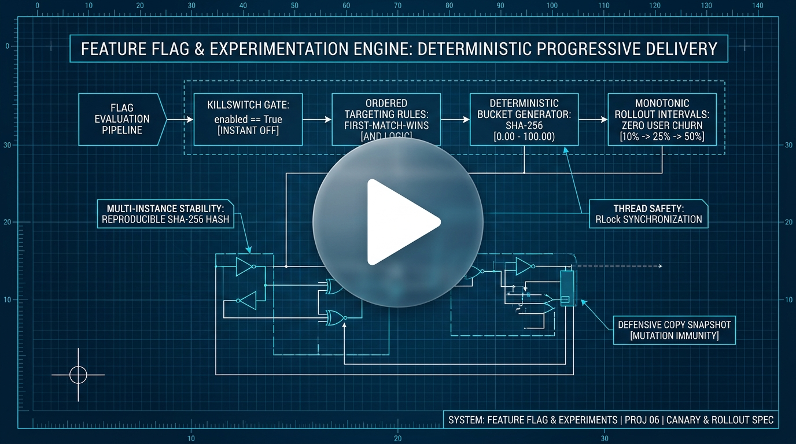
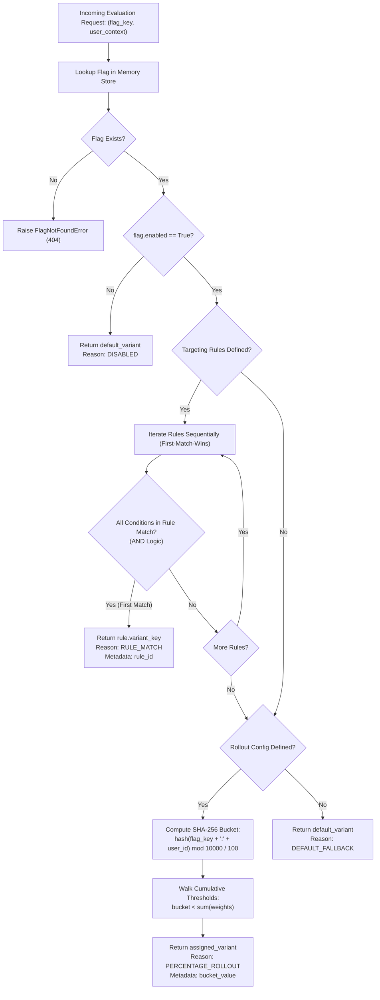

# Project 06: Feature Flag & Experimentation Engine

> **Difficulty:** Medium | **Category:** Systems, Backend, Experimentation, Hashing, Concurrency | **Target Interview Time:** 60 mins

---

## 🎥 Video Walkthrough & Deep Dive (NotebookLM)

> [!TIP]
> **Conceptual Overview & Architecture Breakdown:**  
> A complete visual and audio deep dive covering ordered targeting rule evaluation (first-match-wins AND logic), deterministic SHA-256 percentage bucketing, monotonic rollout stability (zero user churn during ramp-ups), thread-safe RLock concurrency, and defensive snapshot isolation.

<div align="center">

[](https://drive.google.com/file/d/1yt8-pTEtfUqeAtd9wg8mm5rX7aEXgH4Q/view?usp=sharing)

[](https://drive.google.com/file/d/1yt8-pTEtfUqeAtd9wg8mm5rX7aEXgH4Q/view?usp=sharing)

</div>

---

## 1. Problem Statement & Engineering Context

Modern high-velocity software engineering organizations (e.g., LaunchDarkly, Statsig, Split.io, Meta, Netflix) decouple **code deployment** from **feature release**. Rather than deploying new code to 100% of users simultaneously, teams utilize feature flagging and experimentation platforms to:
1. Progressively roll out changes to safe cohorts (canary deployments).
2. Execute multivariate A/B/n experiments with statistical confidence.
3. Target specific user demographics using complex attribute rules.
4. Maintain a real-time kill switch to disable degraded services instantly.

```
Traditional High-Risk Deployment:
Deploy Code ────────────────────────► 100% of All Users (Immediate Exposure / Outage Risk)

Feature Flag Progressive Delivery:
Deploy Dark Code ──► 0% Exposure ──► Target Internal Beta Testers (Rule Match)
                                  ──► Ramp 10% ──► 25% ──► 50% ──► 100% (Monotonic Rollout)
```

### Core Engineering Requirements
- **Feature Flag & Experiment Data Modeling:** Support variations with optional rich payload attachments (e.g. JSON configuration, design tokens, timeout parameters).
- **Configuration Validation & Normalization:** Validate unique keys, valid default variants, non-empty conditions, and exact 100% rollout weight conservation.
- **Ordered Rule Evaluation:** Evaluate targeting rules sequentially with **first-match-wins** semantics and **multi-condition AND** logic.
- **Rich Operator Suite:** Comprehensive comparison operators (`EQUALS`, `NOT_EQUALS`, `IN`, `NOT_IN`, `CONTAINS`, `STARTS_WITH`, `ENDS_WITH`, `GREATER_THAN`, `GREATER_THAN_OR_EQUAL`, `LESS_THAN`, `LESS_THAN_OR_EQUAL`).
- **Deterministic Hashing & Multi-Instance Stability:** Use cryptographic hashing (SHA-256) rather than process-seeded hashing to ensure identical evaluations across distributed nodes and restarts.
- **Monotonic Rollout Stability:** Guarantee that ramping a rollout (e.g. from 10% to 25%) **never causes a user to drop out of their assigned variant**.
- **Defensive Copy Snapshot Isolation:** Prevent external callers from modifying internal service state or mutating variant payload attachments.
- **High-Throughput Concurrency:** Ensure thread-safe reads during dynamic configuration updates without data tearing or race conditions.

---

## 2. System Architecture & Evaluation Pipeline

The evaluation pipeline follows a strict, deterministic 4-stage resolution sequence:



### Memory Layout & Storage Partitions

```
┌────────────────────────────────────────────────────────────────────────┐
│                        FeatureFlagService                              │
│  ┌──────────────────────────────────────────────────────────────────┐  │
│  │ Reentrant Lock: threading.RLock()                                │  │
│  └──────────────────────────────────────────────────────────────────┘  │
│  ┌──────────────────────────────────────────────────────────────────┐  │
│  │ _flags: Dict[str, FeatureFlag]                                    │  │
│  │                                                                  │  │
│  │ "new_checkout_flow" ──► FeatureFlag Object                       │  │
│  │   ├── key: "new_checkout_flow"                                   │  │
│  │   ├── enabled: True                                              │  │
│  │   ├── default_variant: "control"                                 │  │
│  │   ├── variants:                                                  │  │
│  │   │     ├── "control"   ──► Attachment: { "steps": 3 }           │  │
│  │   │     ├── "one_step"  ──► Attachment: { "steps": 1 }           │  │
│  │   │     └── "express"   ──► Attachment: { "express_pay": True }  │  │
│  │   ├── rules (Ordered List):                                      │  │
│  │   │     ├── Rule 1 (id="vip_rule"):                              │  │
│  │   │     │     Conditions: is_vip == True AND tier in [gold]      │  │
│  │   │     │     Variant: "express"                                 │  │
│  │   │     └── Rule 2 (id="internal_rule"):                         │  │
│  │   │           Conditions: email ENDS_WITH "@company.com"         │  │
│  │   │           Variant: "one_step"                                │  │
│  │   └── rollout (Cumulative Interval [0.00, 100.00)):              │  │
│  │         ├── "one_step": [ 0.00,  25.00) (Weight: 25%)            │  │
│  │         └── "control":  [25.00, 100.00) (Weight: 75%)            │  │
│  └──────────────────────────────────────────────────────────────────┘  │
└────────────────────────────────────────────────────────────────────────┘
```

---

## 3. Discrete Mathematical Modeling & Monotonicity Invariants

Let the feature flag state at discrete time $t$ be represented as:

$$\mathcal{S}_t = \langle \mathcal{F}_t, \mathcal{U}_t, \mathcal{H} \rangle$$

Where $\mathcal{F}_t: \text{Key} \to \text{FeatureFlag}$ is the registry of active flag specifications, and $\mathcal{U}_t$ is the user context domain $\mathbf{u} = \langle \text{user-id}, \mathbf{attr} \rangle$.

### 3.1 Rule Evaluation Boolean Algebra
Each targeting rule $R_i$ contains $m_i$ atomic predicates:

$$\mathcal{R}_i(\mathbf{u}) = \bigwedge_{j=1}^{m_i} \mathcal{C}_{i,j}(\mathbf{u})$$

Under ordered first-match-wins semantics, the rule selection index $k^*(\mathbf{u})$ is:

$$k^*(\mathbf{u}) = \min \{ i \in \{1, \dots, n\} \mid \mathcal{R}_i(\mathbf{u}) = \text{True} \}$$

If no rule satisfies the predicate vector ($\forall i, \, \mathcal{R}_i(\mathbf{u}) = \text{False}$), the engine transitions to percentage bucketing.

### 3.2 Deterministic SHA-256 Uniform Hashing
To guarantee reproducible evaluation across any number of server instances without database lookups, the hash bucket $\mathcal{B}(k, u) \in [0.00, 100.00)$ is calculated as:

$$\text{hash-input} = k \mathbin{\Vert} \text{":"} \mathbin{\Vert} u$$

$$\mathcal{H} = \text{SHA256}(\text{hash-input})$$

$$\text{IntegerDigest} = \sum_{i=0}^{7} \mathcal{H}[i] \times 16^{7-i} \quad (\text{First 32 bits})$$

$$\mathcal{B}(k, u) = \frac{\text{IntegerDigest} \bmod 10000}{100.0}$$

### 3.3 Monotonic Rollout Guarantee (Zero Churn Invariant)
Let $P_1$ and $P_2$ be two consecutive deployment percentages for a feature variant $V_{\text{treatment}}$, where $P_1 < P_2 \le 100.0$:

$$\text{Cohort}(P) = \{ u \in \text{Users} \mid \mathcal{B}(k, u) < P \}$$

$$\forall u \in \text{Users}, \quad \mathcal{B}(k, u) < P_1 \implies \mathcal{B}(k, u) < P_2$$

$$\text{Cohort}(P_1) \subseteq \text{Cohort}(P_2)$$

$$\text{User Churn} = |\text{Cohort}(P_1) \setminus \text{Cohort}(P_2)| = 0$$

> **Guaranteed Engineering Property:** As teams ramp up a rollout from 10% to 25% to 50%, users who were assigned the new feature variant never experience regressions back to the control group.

### 3.4 Multi-Variant Cumulative Threshold Intervals
For an experiment with $M$ variants having weights $w_1, w_2, \dots, w_M$ such that $\sum_{m=1}^M w_m = 100.0$:

$$\text{Interval}_m = \left[ \sum_{j=1}^{m-1} w_j, \; \sum_{j=1}^m w_j \right)$$

$$\mathcal{V}(\mathbf{u}) = V_m \iff \mathcal{B}(k, u) \in \text{Interval}_m$$

---

## 4. Step-by-Step State Timeline Walkthrough (Real Figures)

Below is an exact chronological execution trace demonstrating flag registration, ordered rule overrides, deterministic bucketing, monotonic ramp-up stability, and defensive copy snapshot protection:

| Step | Operation Executed | Input Payload / Context | Evaluated Decision Path | Resolved Variant | Reason Code | Explanatory Notes & Invariants |
|:---:|---|---|---|:---:|:---:|---|
| **0** | `create_flag` | `key="checkout_flow"`, variants: `control`, `one_step`, `express`, default: `control` | Config validated & stored | — | — | Service initialized. Rules and 20% rollout configured. |
| **1** | `evaluate` | User Alice: `id="alice"`, `is_vip=True`, `tier="gold"` | Matches Rule 1 (`is_vip == True AND tier == gold`) | **`express`** | `RULE_MATCH` | First-match-wins rule override. Bypasses rollout bucketing. |
| **2** | `evaluate` | User Bob: `id="bob"`, `email="bob@company.com"`, `is_vip=False` | Matches Rule 2 (`email ENDS_WITH @company.com`) | **`one_step`** | `RULE_MATCH` | Second rule triggered; internal employee cohort. |
| **3** | `evaluate` | User Charlie: `id="charlie"`, no attributes | No rule match $\to$ `SHA256("checkout_flow:charlie")` $\to$ Bucket: **`14.52`** | **`one_step`** | `PERCENTAGE_ROLLOUT` | Falls in $[0.00, 20.00)$ interval. Assigned `one_step`. |
| **4** | `evaluate` | User Dave: `id="dave"`, no attributes | No rule match $\to$ `SHA256("checkout_flow:dave")` $\to$ Bucket: **`42.18`** | **`control`** | `PERCENTAGE_ROLLOUT` | Falls in $[20.00, 100.00)$ interval. Assigned `control`. |
| **5** | `update_flag` | Ramp rollout from **20%** $\to$ **50%** | Cumulative interval for `one_step` expands to $[0.00, 50.00)$ | — | — | Atomic update under reentrant lock. |
| **6** | `evaluate` | User Charlie: `id="charlie"` (Re-evaluation) | Bucket remains **`14.52`** | **`one_step`** | `PERCENTAGE_ROLLOUT` | **Monotonic Stability:** User Charlie remains in `one_step`! Zero churn. |
| **7** | `evaluate` | User Dave: `id="dave"` (Re-evaluation) | Bucket remains **`42.18`** $< 50.00$ | **`one_step`** | `PERCENTAGE_ROLLOUT` | User Dave smoothly transitions from `control` to `one_step`. |
| **8** | `mutation_attempt` | `res = evaluate("checkout_flow", Alice); res.attachment["steps"] = 9999` | Malicious external mutation | **DEFENDED** | — | **Defensive Copy Invariant:** Subsequent calls retrieve pristine `{steps: 1}`. |
| **9** | `update_flag` | Emergency Killswitch: `enabled=False` | Master switch toggled | — | — | Instant platform kill switch activated. |
| **10** | `evaluate` | User Alice (Re-evaluation) | Bypasses all rules and rollouts | **`control`** | `DISABLED` | Disabled flag immediately returns default fallback. |

---

## 5. Thread Safety & Concurrency Model

### 5.1 Synchronization Primitive: `threading.RLock`
The service protects all read-modify-write state changes using a reentrant lock:

```python
with self._lock:
    # Atomic lookup, rule evaluation, or configuration mutation
    ...
```

#### Why Reentrant Lock (`RLock`) over Standard `Lock`?
- **Nested Service Calls:** Methods like `evaluate_all()` iterate over all registered flags while invoking `evaluate_flag()`. An `RLock` allows the calling thread to acquire the lock multiple times without self-deadlock.
- **Reader Consistency during Live Writes:** Feature flags are read-heavy ($99.99\%$ reads, $0.01\%$ writes). Synchronizing under `RLock` ensures that reading threads never observe partially updated rules, broken variant pointers, or invalid weight transitions.

### 5.2 Time & Space Complexity Analysis

| Operation | Method Signature | Time Complexity | Auxiliary Space | Operational Description |
|---|---|:---:|:---:|---|
| **Create Flag** | `create_flag(...)` | $\mathcal{O}(V + R \times C)$ | $\mathcal{O}(V + R \times C)$ | Validation of $V$ variants, $R$ rules with $C$ conditions. |
| **Get Flag** | `get_flag(flag_key)` | $\mathcal{O}(V + R \times C)$ | $\mathcal{O}(V + R \times C)$ | $O(1)$ dictionary lookup + deep copy snapshot. |
| **Update Flag** | `update_flag(...)` | $\mathcal{O}(V + R \times C)$ | $\mathcal{O}(V + R \times C)$ | Atomic validation and in-place replacement. |
| **Delete Flag** | `delete_flag(flag_key)` | $\mathcal{O}(1)$ | $\mathcal{O}(1)$ | Hash table key deletion. |
| **Evaluate Flag** | `evaluate(flag_key, context)` | $\mathcal{O}(R \times C + \log M)$ | $\mathcal{O}(1)$ | Rule iteration + SHA-256 hash calculation + rollout search. |
| **Evaluate All** | `evaluate_all(context)` | $\mathcal{O}(N \times (R \times C))$ | $\mathcal{O}(N)$ | Evaluating all $N$ active platform flags. |

---

## 6. REST API Specification

The service includes a production-ready Flask REST adapter ([`src/app.py`](./src/app.py)):

| HTTP Method | Route | Request Body | Success Status | Error Codes | Description |
|---|---|---|:---:|:---:|---|
| `POST` | `/api/flags` | `{"key": "f1", "name": "...", "variants": [...], "default_variant": "..."}` | `201 Created` | `400, 409` | Creates a new feature flag with rules and rollout. |
| `GET` | `/api/flags` | *None* | `200 OK` | — | Lists all registered feature flags. |
| `GET` | `/api/flags/<flag_key>` | *None* | `200 OK` | `404` | Retrieves flag configuration snapshot. |
| `PUT` | `/api/flags/<flag_key>` | `{"enabled": false, "rollout": {...}}` | `200 OK` | `400, 404` | Atomically updates flag parameters. |
| `DELETE` | `/api/flags/<flag_key>` | *None* | `200 OK` | `404` | Deletes a feature flag. |
| `POST` | `/api/flags/<flag_key>/evaluate` | `{"user_id": "u1", "attributes": {"beta": true}}` | `200 OK` | `400, 404` | Evaluates single flag for specified user context. |
| `POST` | `/api/evaluate` | `{"user_id": "u1", "attributes": {...}}` | `200 OK` | `400` | Evaluates all flags for user context. |
| `GET` | `/api/stats` | *None* | `200 OK` | — | Retrieves aggregate service metrics (`total_flags`, `active_flags`, etc.). |

---

## 7. Failure Modes & Defensive Mitigations

| Vulnerability / Edge Case | Naive Implementation Failure | Service Defensive Mitigation |
|---|---|---|
| **Python Boolean Trap** | `isinstance(True, int) is True` causes boolean `True` to match numeric `1` or pass numeric comparison. | Explicitly checks `if isinstance(actual, bool) != isinstance(expected, bool): return False` and rejects booleans in numeric comparisons. |
| **Process Seed Hash Divergence** | Python's built-in `hash()` uses randomized process salt (`PYTHONHASHSEED`), causing identical users to receive different variants on different servers. | Uses cryptographic `hashlib.sha256()`, guaranteeing 100% identical hash distribution across all processes, machines, and restarts. |
| **Rollout Churning Bug** | Re-sorting or randomizing bucketing intervals causes existing users to lose their assigned feature when percentage increases. | Cumulative interval bucketing guarantees monotonic superset inclusion ($\text{Cohort}(P_1) \subseteq \text{Cohort}(P_2)$). |
| **Attachment Defacement** | Returning direct object references allows external callers to mutate shared config payloads in memory. | Deep copy snapshot isolation (`copy.deepcopy()`) decouples caller responses from internal storage. |
| **Rollout Weight Leakage** | Rollout weights summing to $90\%$ or $110\%$ cause unassigned gaps or out-of-bounds index errors. | Strict validation enforces $\left| \sum w_i - 100.0 \right| \le 0.01$. |
| **Missing Attribute Crash** | Evaluating an unsupplied attribute raises `KeyError` or crashes the rule evaluator. | Evaluator safely catches missing attributes and returns `False` for positive operators (`EQUALS`, `IN`, `CONTAINS`) and `True` for negative operators (`NOT_EQUALS`, `NOT_IN`). |

---

## 8. Verification & Automated Test Suite

Project 06 is validated by **34 automated pytest test cases** spanning configuration management, targeting operators, rule ordering, deterministic stability, concurrency, and REST API contracts:

```bash
# Execute Proj_06 test suite (34 passing tests)
python -m pytest Proj_06/tests/ -v

# Execute entire repository test suite (207 passing tests)
python -m pytest -v
```

### Test Suite Directory Breakdown

- [`test_flag_crud.py`](./tests/test_flag_crud.py):
  - **Lifecycle Validation:** Verifies flag creation, retrieval, updates, and deletion.
  - **Key Format Checks:** Rejects spaces and illegal characters in flag keys.
  - **Duplicate Rejection:** Asserts `FlagAlreadyExistsError` on conflicting keys.
  - **Variant Integrity:** Verifies `default_variant`, rules, and rollouts must reference defined variants.
  - **Rollout Conservation:** Rejects negative weights and weights that do not sum to 100.0.
  - **Metrics Tracking:** Verifies `get_stats()` accurately tracks active vs inactive flags.

- [`test_rule_operators.py`](./tests/test_rule_operators.py):
  - **Equality Operators:** Validates `EQUALS` and `NOT_EQUALS` across strings, integers, floats, and booleans.
  - **Boolean Trap Defense:** Asserts `True != 1` and `False != 0` under equality checks.
  - **Collection Operators:** Tests `IN` and `NOT_IN` with type-safe membership checking.
  - **String Operators:** Validates `CONTAINS`, `STARTS_WITH`, and `ENDS_WITH` with graceful non-string handling.
  - **Numeric Comparisons:** Tests `>`, `>=`, `<`, `<=` across integers and floats; strictly rejects boolean inputs.
  - **Missing Attributes:** Proves missing attributes fail positive checks and satisfy negative checks safely.

- [`test_ordered_rule_evaluation.py`](./tests/test_ordered_rule_evaluation.py):
  - **First-Match-Wins Ordering:** Proves when a user satisfies multiple rules, only the first matching rule triggers.
  - **AND Semantics:** Asserts rules with multiple conditions fail if even one condition is unsatisfied.
  - **Killswitch Override:** Proves disabled flags bypass all rules and return `default_variant` with `DISABLED` reason.
  - **Bulk Evaluation:** Validates `evaluate_all()` for multi-flag resolution.

- [`test_deterministic_rollout.py`](./tests/test_deterministic_rollout.py):
  - **Hash Determinism:** Validates 100% reproducible hash buckets across 50 iterations.
  - **Monotonic Stability Ramp-Up:** Simulates 250 users transitioning through 10% $\to$ 25% $\to$ 50% $\to$ 100% rollout, proving zero user churn.
  - **Multivariate Bucketing:** Validates exact 3-way distribution across non-uniform weights (`30% / 20% / 50%`).
  - **Uniform Distribution:** Verifies 1000 simulated users distribute evenly across the $[0.00, 100.00)$ spectrum.

- [`test_feature_flag_defensive_copies.py`](./tests/test_feature_flag_defensive_copies.py):
  - **Flag Mutation Resistance:** Proves calling `.clear()` on retrieved variants or rules leaves service state intact.
  - **Attachment Mutation Resistance:** Proves mutating returned nested dictionaries does not corrupt stored payloads.
  - **List Mutation Resistance:** Validates caller modifications to `list_flags()` outputs do not alter internal storage.

- [`test_feature_flag_concurrency.py`](./tests/test_feature_flag_concurrency.py):
  - **Concurrent Reads During Dynamic Writes:** 25 reader threads evaluating flags while 5 writer threads actively mutate rules and rollout percentages without deadlocks or exceptions.
  - **Parallel Flag Creation:** 25 concurrent threads registering distinct flags without collision.
  - **High-Throughput Throughput:** 100 parallel evaluations across 5 flags.

- [`test_feature_flag_flask_api.py`](./tests/test_feature_flag_flask_api.py):
  - **REST Endpoint Coverage:** Full integration testing of `POST /api/flags`, `GET /api/flags`, `PUT /api/flags/<key>`, `DELETE /api/flags/<key>`, and `POST /api/flags/<key>/evaluate`.
  - **HTTP Status Mapping:** Validates `201 Created`, `200 OK`, `400 Bad Request`, `404 Not Found`, and `409 Conflict`.

---

## 9. Practical Interview Tradeoffs & System Design Talking Points

When presenting this architecture in a senior engineering interview:

1. **Why Cryptographic SHA-256 Over Python's Built-in `hash()`?**
   - **Multi-Instance Divergence:** Python's built-in `hash()` is randomized on process startup (`PYTHONHASHSEED`) to prevent hash-DoS attacks. In a distributed deployment with multiple Gunicorn workers or Kubernetes pods, `hash("user123")` would return different values on different servers, causing a user to flicker between control and treatment on every HTTP request! SHA-256 is strictly deterministic across all machines, languages, and processes.

2. **How to Prevent Experiment Spillover / Correlation Bias Across Different Flags?**
   - If two different flags use the same hashing function $\text{hash}(u)$, every user in the top 10% of Flag A would also be in the top 10% of Flag B!
   - **Salt / Flag-Key Prefixing:** By hashing the composite string $k \mathbin{\Vert} \text{":"} \mathbin{\Vert} u$, the user's bucket value in Flag A is completely uncorrelated with their bucket value in Flag B.

3. **How Does an In-Memory Flag Engine Scale to 500,000 QPS at the Edge?**
   - **No Database Round-Trip on Evaluation:** Evaluating a flag requires **zero database I/O**. Because the rules and hashing are evaluated locally in-memory, evaluation latency is sub-millisecond ($\sim 5\mu s$).
   - **SDK Local Cache + Push Streaming:** Instead of applications making HTTP calls to a centralized flag server on every user request, an application embeds an in-process SDK. The SDK maintains an in-memory replica of the flag configuration and connects to the flag server via a persistent Server-Sent Events (SSE) or gRPC streaming connection to receive real-time configuration delta updates.

4. **Why Deep Copy Snapshots vs Immutable Types (`pyrsistent` / `frozen=True`)?**
   - In pure Python, deep copying mutable dictionaries ensures zero side-channel state pollution. In performance-critical production systems, we can optimize this by using immutable persistent data structures or frozen dataclasses, eliminating allocation overhead while preserving 100% mutation safety.
