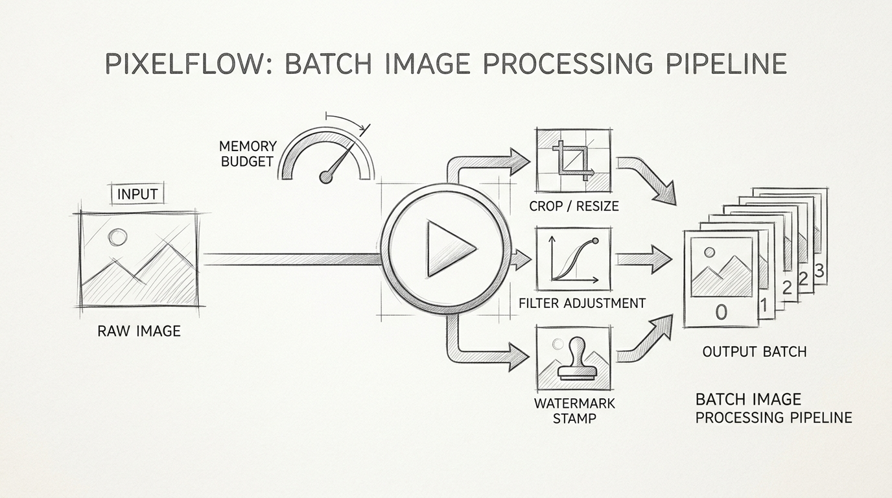
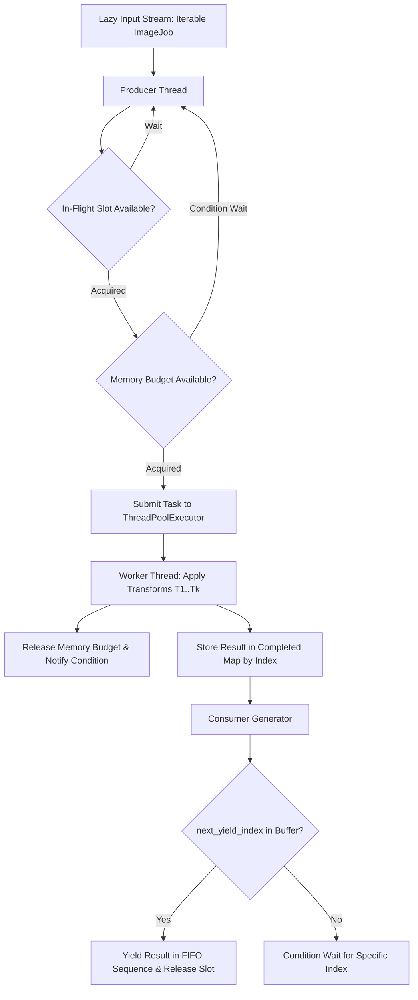

# Project 07: PixelFlow — Batch Image Processing Pipeline

> **Difficulty:** Medium | **Category:** Concurrency, Task Scheduling, Memory Management, Lazy Iteration | **Target Interview Time:** 45 mins

---

## 🎥 Video Walkthrough & Deep Dive (NotebookLM)

> [!TIP]
> **Conceptual Overview & Architecture Breakdown:**  
> A complete visual and audio explanation covering batch image processing pipelines, FIFO admission, thread pool task scheduling, bounded memory budgeting with condition variables, failure isolation, and deterministic result reordering.

<div align="center">

[](https://drive.google.com/file/d/1YP1BlzgUOpqJDH5-FgT7lzwo6eWZ9GmY/view?usp=sharing)

[](https://drive.google.com/file/d/1YP1BlzgUOpqJDH5-FgT7lzwo6eWZ9GmY/view?usp=sharing)

</div>

---

## 1. Problem Statement & Context

In high-scale media processing architectures (e.g., Cloudinary, Imgix, Netflix encoding pipelines), thousands of heterogeneous image transformation jobs (resizing, color conversions, watermarking, filters) must be executed continuously without exhausting server resources or crashing under corrupted payloads.

PixelFlow is an in-memory batch image processing engine designed to satisfy six rigorous engineering constraints:
1. **Ordered Transformations**: Each image must pass through an immutable, strictly ordered sequence of transformation steps ($T_1 \to T_2 \to \dots \to T_k$).
2. **Concurrent Task Execution**: Independent images must be processed concurrently across a bounded worker thread pool (`max_workers`).
3. **In-Flight Memory Budgeting**: The pipeline must enforce a strict maximum memory budget (`max_memory_bytes`) based on raw image payload size, blocking new jobs until finished jobs release memory.
4. **FIFO Admission Control**: Jobs must be admitted into the execution pool in strict First-In, First-Out sequence as capacity becomes available.
5. **Deterministic Result Ordering**: Results must be yielded to the caller in the exact order of the original input sequence, even if later jobs finish earlier than earlier ones.
6. **Failure Isolation**: A fatal error or corrupted image in one job must be isolated (returning `success = False`), ensuring other in-flight and queued jobs complete unaffected.
7. **Bounded Lazy Consumption**: Input streams (`Iterable[ImageJob]`) must be consumed on-demand without pre-materializing large batches into memory.

---

## 2. System Architecture & Concurrency Model



---

## 3. Step-by-Step Execution Walkthrough (With Real Figures)

### 3.1 Deterministic Output Reordering with Variable Latency

> **Scenario:** Job 0 is a heavy image taking 80ms, while Jobs 1, 2, and 3 are lightweight and finish in 10ms to 30ms.

| Time ($t$) | Worker Event | Completed Buffer State | Next Yield Index | Output Stream Action |
|---|---|---|:---:|---|
| **$t = 0\text{ms}$** | Jobs 0, 1, 2, 3 admitted | `{}` | `0` | Waiting for Job 0. |
| **$t = 10\text{ms}$** | Job 1 finishes | `{1: Res_1}` | `0` | **Buffered**: Job 1 cannot be yielded before Job 0. |
| **$t = 20\text{ms}$** | Job 3 finishes | `{1: Res_1, 3: Res_3}` | `0` | **Buffered**: Waiting for Job 0. |
| **$t = 30\text{ms}$** | Job 2 finishes | `{1: Res_1, 2: Res_2, 3: Res_3}` | `0` | **Buffered**: Waiting for Job 0. |
| **$t = 80\text{ms}$** | Job 0 finishes | `{0: Res_0, 1: Res_1, 2: Res_2, 3: Res_3}` | `0` | **Cascade Yield:**<br>1. Yields `Res_0` (Index advances to 1)<br>2. Yields `Res_1` (Index advances to 2)<br>3. Yields `Res_2` (Index advances to 3)<br>4. Yields `Res_3` (Index advances to 4) |

- **Key Takeaway:** The client receives results in exact sequence `[Job 0, Job 1, Job 2, Job 3]`, completely abstracting away out-of-order multi-threaded worker execution.

---

### 3.2 In-Flight Memory Budgeting & FIFO Admission

> **Configuration:** `max_memory_bytes = 150 KB`. Each job is `50 KB`.

| Time ($t$) | Action | Requested | In-Flight Memory | Available Budget | Admission Status |
|---|---|:---:|:---:|:---:|:---:|
| **$t = 0\text{ms}$** | Job 0 enters | 50 KB | 50 KB | 100 KB | **Admitted** (Worker 1 started) |
| **$t = 2\text{ms}$** | Job 1 enters | 50 KB | 100 KB | 50 KB | **Admitted** (Worker 2 started) |
| **$t = 4\text{ms}$** | Job 2 enters | 50 KB | 150 KB | 0 KB | **Admitted** (Worker 3 started) |
| **$t = 6\text{ms}$** | Job 3 enters | 50 KB | 150 KB | 0 KB | **BLOCKED** on `Condition.wait()` |
| **$t = 25\text{ms}$** | Job 1 finishes | -50 KB | 100 KB | 50 KB | Memory released $\to$ `Condition.notify_all()` |
| **$t = 26\text{ms}$** | Job 3 wakes | 50 KB | 150 KB | 0 KB | **Admitted** (Worker 2 started on Job 3) |

- **Peak Memory Invariant:** In-flight memory is mathematically capped at `150 KB` at all times, preventing Out-Of-Memory (OOM) crashes under heavy concurrency.

---

### 3.3 Failure Isolation (Corrupted Payload Handling)

> **Scenario:** Job 2 contains corrupted image data that throws an unhandled exception during transform step 2.

| Job ID | Input State | Transform Step 1 (Grayscale) | Transform Step 2 (Resize) | Pipeline Outcome | Memory Status |
|---|---|:---:|:---:|:---:|:---:|
| **Job 0** | Valid | Succeeded | Succeeded | `success = True` | Memory released cleanly |
| **Job 1** | Valid | Succeeded | Succeeded | `success = True` | Memory released cleanly |
| **Job 2** | Corrupted | Succeeded | **Failed (Exception)** | **`success = False`**<br>`error = "Corrupt image data at byte 42"` | **Memory released in `finally` block** |
| **Job 3** | Valid | Succeeded | Succeeded | `success = True` | Memory released cleanly |

- **Fault Isolation:** The exception is intercepted; Job 2 returns a structured error record without bringing down worker threads or interrupting the remaining jobs.

---

### 3.4 Bounded Lazy Streaming & Backpressure

To prevent memory leaks when reading from infinite or gigabyte-scale job iterators:
- The pipeline utilizes a producer-consumer semaphore `in_flight_semaphore` initialized to `max_in_flight_jobs` (default: $2 \times \text{maxWorkers}$).
- The producer thread pauses pulling from `Iterable[ImageJob]` whenever all in-flight slots are occupied.
- Slots are only released when the consumer generator yields an item, providing natural backpressure matching the client's consumption speed.

---

## 4. Engineering Decisions: Standard Library vs. Pillow

### Why Pure Standard Library for Core Transforms?
1. **Zero External Dependencies**: Built using standard Python (`bytes`, `threading`, `concurrent.futures`), making the pipeline 100% portable across minimal CI/CD containers and interview evaluation environments without C-library dependencies (`libjpeg`, `zlib`).
2. **Byte-Level Memory Accuracy**: Raw payload sizing (`len(image.data)`) provides deterministic memory budgeting. In contrast, Pillow uncompresses images into large C-memory bitmap arrays, obscuring in-flight memory usage.

### Pluggable Pillow Integration
The pipeline is fully decoupled via `ImageTransform` and `CallableTransform`. Pillow filters can be dropped in seamlessly whenever desired:

```python
import io
from PIL import Image, ImageFilter
from Proj_07.src.models import ImageData
from Proj_07.src.transforms import CallableTransform

def pillow_blur_filter(img: ImageData) -> ImageData:
    pil_img = Image.open(io.BytesIO(img.data))
    blurred = pil_img.filter(ImageFilter.GaussianBlur(radius=2))
    buf = io.BytesIO()
    blurred.save(buf, format="PNG")
    return ImageData(img.image_id, buf.getvalue(), img.metadata)

blur_transform = CallableTransform("gaussian_blur", pillow_blur_filter)
```

---

## 5. Complexity Analysis

| Operation | Time Complexity | Space Complexity | Explanation |
|---|:---:|:---:|---|
| **Pipeline Processing** | $O(N \times K)$ | $O(\text{Budget} + \text{InFlight})$ | $N$ images passed through $K$ transformation steps. Space is bounded strictly by the defined memory budget and in-flight queue size. |
| **FIFO Admission** | $O(1)$ amortized | $O(1)$ | Lock acquisition and Condition variable wait/notify. |
| **Deterministic Yield** | $O(1)$ lookup | $O(\text{InFlight})$ | Dictionary hash lookup by integer index `completed_results.pop(next_index)`. |

---

## 6. Interview Talking Points & Follow-Ups

- **Q: Why use `threading.Condition` instead of polling with `time.sleep()`?**  
  *Answer:* Polling wastes CPU cycles and adds artificial latency between checks. `threading.Condition` allows worker threads to sleep until `release()` explicitly invokes `notify_all()`, resuming the exact waiting thread with zero CPU overhead and immediate response time.
- **Q: What if an individual image exceeds `max_memory_bytes`?**  
  *Answer:* If an image's size strictly exceeds the total budget, waiting on the condition variable would result in a permanent deadlock. Our pipeline intercepts this in `producer_worker` and immediately returns a failed `TransformResult(success=False, error="exceeds total memory budget")` without deadlocking the queue.
- **Q: How would you scale this pipeline across multiple machines?**  
  *Answer:* The in-memory `ThreadPoolExecutor` and `MemoryBudgetManager` are abstracted into distributed worker nodes via Celery or Temporal. Jobs are streamed through a distributed queue (e.g. Apache Kafka or RabbitMQ) partitioned by batch ID, while Redis or S3 stores intermediate artifacts between stages.

---

## 7. Verification & Testing

Execute the complete suite of functional, concurrency, and memory budget tests:

```bash
python -m pytest Proj_07/tests -v
```

Expected output: 17 tests passed covering transform chains, memory ceiling enforcement, deterministic reordering, failure isolation, and lazy streaming.
