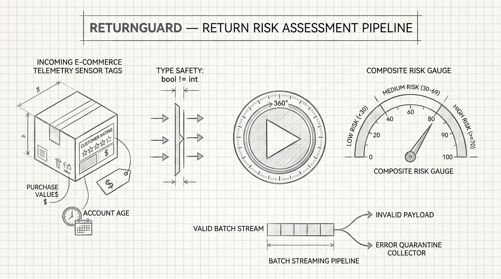
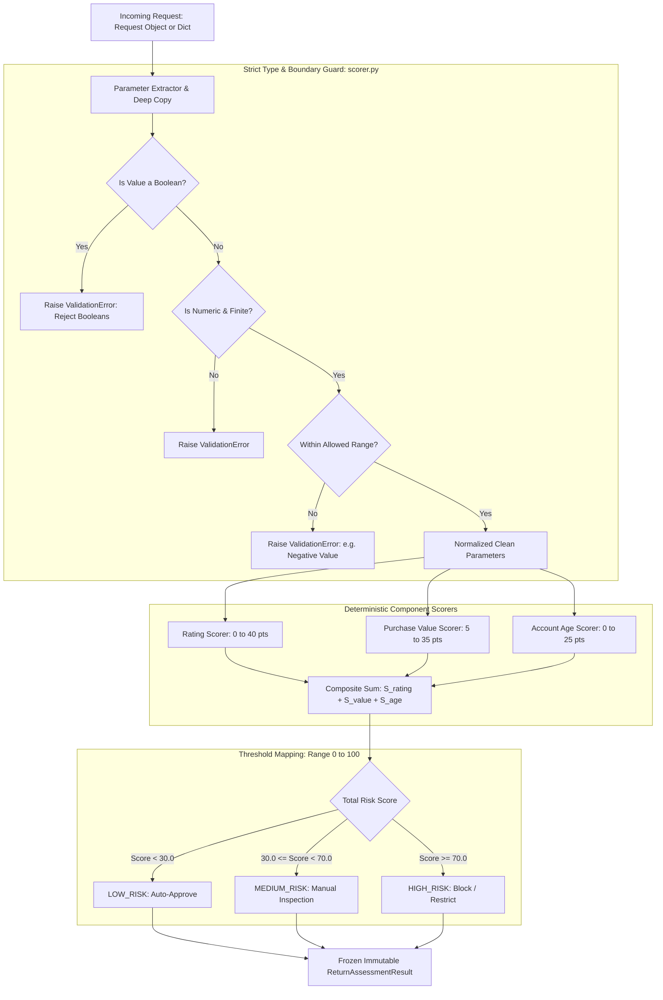
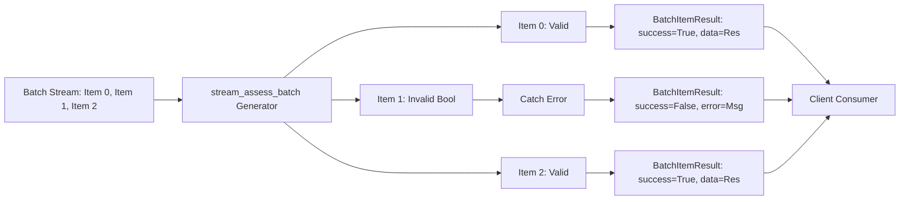

# Project 09: ReturnGuard — Return Risk Assessment Pipeline

> **Difficulty:** Easy | **Category:** Type Safety, Boundary Conditions, Batch Processing, Stateless Design | **Target Interview Time:** 45 mins

---

## 🎥 Video Walkthrough & Deep Dive (NotebookLM)

> [!TIP]
> **Conceptual Overview & Architecture Breakdown:**  
> A complete visual and audio explanation covering ReturnGuard's risk assessment engine, the notorious Python boolean type inheritance trap, deterministic tiered scoring, precise boundary fenceposts, batch failure isolation, and streaming generators.

<div align="center">

[](https://drive.google.com/file/d/1oq97qDN4JaX8iFCrvrcmd2TisX3pd5Ds/view?usp=sharing)

[](https://drive.google.com/file/d/1oq97qDN4JaX8iFCrvrcmd2TisX3pd5Ds/view?usp=sharing)

</div>

---

## 1. Problem Statement & Engineering Context

In e-commerce operations (e.g., Amazon, Shopify, Zalando, Returnly), return abuse (wardrobing, empty-box fraud, serial returners) costs retailers tens of billions of dollars annually. To mitigate risk without alienating loyal customers, platforms run automated risk assessment pipelines evaluating order-level and customer-level telemetry.

ReturnGuard is a high-throughput, stateless risk scoring pipeline evaluating customer ratings, purchase values, and account longevity. The legacy implementation suffered from four major engineering flaws:
1. **The Python Boolean Subclass Trap**: In Python, `bool` is a subclass of `int` (`isinstance(True, int) is True`). Passing `True` or `False` slipped through numeric type checks, treating boolean flags as ratings (1.0) or purchase values ($1.00).
2. **Boundary Fencepost Inconsistencies**: Ambiguous inequality checks (`<` vs `<=`) caused scores to fluctuate inconsistently at exact threshold tiers (e.g., 30 days, 90 days, $50, $200).
3. **Batch Failure Cascading**: A single malformed payload in a batch of thousands of items threw an unhandled exception, terminating the entire batch job and losing all downstream calculations.
4. **Data Pollution & Lack of Isolation**: Modifying returned result structures or caller metadata mutated internal scoring logic or subsequent evaluations.

This project delivers a repaired, robust, and 100% type-safe reference implementation featuring strict type enforcement, deterministic tiered scoring, single-pass streaming batch error isolation, and complete data immutability.

---

## 2. Pipeline Architecture & Scoring Engine



### Batch Error Isolation Model



---

## 3. Root Cause Analysis & Step-by-Step State Timelines

### 3.1 Deep-Dive: The Python Boolean Inheritance Trap

> **Python Language Quirks**: In the Python C-API and object model:
> ```python
> issubclass(bool, int) == True
> isinstance(True, int) == True
> isinstance(False, int) == True
> True + 41 == 42
> ```
> Naive validation code like `if not isinstance(val, (int, float)): raise TypeError(...)` allows `True` to pass as a numeric value. In ReturnGuard, passing `customer_rating = True` would evaluate `1.0` rating, artificially inflating risk!

#### Vulnerable vs. Repaired Implementation

```python
# VULNERABLE CODE (Legacy)
if not isinstance(customer_rating, (int, float)):
    raise TypeError("Invalid rating")  # True and False slip right through!

# REPAIRED CODE (ReturnGuard)
if isinstance(customer_rating, bool):
    raise InvalidRatingError("customer_rating cannot be a boolean value")
if not isinstance(customer_rating, (int, float)):
    raise InvalidRatingError("customer_rating must be a numeric value")
```

| Submitted Field | Value | Legacy Behavior | ReturnGuard Behavior | System Security Impact |
|---|:---:|---|---|---|
| `customer_rating` | `True` | Accepted as 1.0 (Assigned 40 pts) | **Rejected (`InvalidRatingError`)** | Prevents false penalty on customer |
| `purchase_value` | `False` | Accepted as $0.00 (Assigned 5 pts) | **Rejected (`InvalidPurchaseValueError`)** | Prevents fraudulent zero-cost returns |
| `account_age_days` | `True` | Accepted as 1 day (Assigned 25 pts) | **Rejected (`InvalidAccountAgeError`)** | Prevents brand new account penalty |

---

### 3.2 Component Scoring Tiers & Precise Boundaries

The composite score $\mathcal{R} \in [5.0, 100.0]$ is calculated across three orthogonal dimensions:

| Component | Condition / Tier | Component Score | Human-Readable Audit Reason |
|---|---|:---:|---|
| **Customer Rating** ($[0.0, 5.0]$) | $\text{rating} \ge 4.5$ | **`0.0 pts`** | `"Excellent customer rating (>= 4.5)"` |
| | $3.5 \le \text{rating} < 4.5$ | **`10.0 pts`** | `"Good customer rating (3.5 - 4.4)"` |
| | $2.5 \le \text{rating} < 3.5$ | **`25.0 pts`** | `"Average customer rating (2.5 - 3.4)"` |
| | $\text{rating} < 2.5$ | **`40.0 pts`** | `"Low customer rating (< 2.5)"` |
| **Purchase Value** ($\ge 0.0$) | $\text{value} < 50.00$ | **`5.0 pts`** | `"Low purchase value (< $50)"` |
| | $50.00 \le \text{value} < 200.00$ | **`15.0 pts`** | `"Standard purchase value ($50 - $199.99)"` |
| | $200.00 \le \text{value} < 1000.00$ | **`25.0 pts`** | `"High purchase value ($200 - $999.99)"` |
| | $\text{value} \ge 1000.00$ | **`35.0 pts`** | `"Luxury/extreme purchase value (>= $1000)"` |
| **Account Age** ($\ge 0\text{ days}$) | $\text{age} \ge 365$ | **`0.0 pts`** | `"Established veteran account (>= 1 year)"` |
| | $90 \le \text{age} < 365$ | **`5.0 pts`** | `"Established account (90 - 364 days)"` |
| | $30 \le \text{age} < 90$ | **`15.0 pts`** | `"Maturing account (30 - 89 days)"` |
| | $\text{age} < 30$ | **`25.0 pts`** | `"New account (< 30 days)"` |

---

### 3.3 Batch Processing & Error Isolation State Trace

> **Scenario:** A batch of 6 items containing valid orders, boolean trap payloads, and negative values is submitted via `assess_batch`.

| Batch Index | Input Payload | Validation Status | Score Breakdown ($S_r + S_v + S_a$) | Batch Result Status | Output Decision / Error |
|:---:|---|:---:|:---:|:---:|---|
| **0** | `rating: 4.8, value: 30, age: 400` | Valid | $0 + 5 + 0 = 5.0\text{ pts}$ | `success = True` | **`LOW_RISK`** |
| **1** | `rating: True, value: 100, age: 50` | **Boolean Trap!** | *Execution halted* | `success = False` | `InvalidRatingError: cannot be a boolean` |
| **2** | `rating: 2.0, value: 1200, age: 10` | Valid | $40 + 35 + 25 = 100.0\text{ pts}$ | `success = True` | **`HIGH_RISK`** |
| **3** | `rating: 4.0, value: -99, age: 50` | **Negative Value!** | *Execution halted* | `success = False` | `InvalidPurchaseValueError: cannot be negative` |
| **4** | `rating: 3.8, value: 150, age: 120` | Valid | $10 + 15 + 5 = 30.0\text{ pts}$ | `success = True` | **`MEDIUM_RISK`** |
| **5** | `value: 150, age: 120` *(No rating)* | **Missing Field!** | *Execution halted* | `success = False` | `ValidationError: Missing required field` |

- **Verification**: Outputs are strictly ordered $\{0, 1, 2, 3, 4, 5\}$. Failures on items 1, 3, and 5 do not crash the runner or corrupt the successful assessments on items 0, 2, and 4.

---

## 4. Mathematical Modeling & Algorithmic Formulation

### 4.1 Composite Risk Formulation

Let the input vector be $\mathbf{x} = (r, v, a) \in [0, 5] \times [0, \infty) \times \mathbb{N}_0$.
The component scoring functions are step-wise piecewise definitions:

$$
S_{\text{rating}}(r) = \begin{cases}
0 & \text{if } r \ge 4.5 \\
10 & \text{if } 3.5 \le r < 4.5 \\
25 & \text{if } 2.5 \le r < 3.5 \\
40 & \text{if } r < 2.5
\end{cases}
$$

$$
S_{\text{value}}(v) = \begin{cases}
5 & \text{if } v < 50 \\
15 & \text{if } 50 \le v < 200 \\
25 & \text{if } 200 \le v < 1000 \\
35 & \text{if } v \ge 1000
\end{cases}
$$

$$
S_{\text{age}}(a) = \begin{cases}
0 & \text{if } a \ge 365 \\
5 & \text{if } 90 \le a < 365 \\
15 & \text{if } 30 \le a < 90 \\
25 & \text{if } a < 30
\end{cases}
$$

The total risk score $\mathcal{R}(\mathbf{x})$ is the bounded sum:

$$
\mathcal{R}(\mathbf{x}) = \min(100.0, \max(0.0, S_{\text{rating}}(r) + S_{\text{value}}(v) + S_{\text{age}}(a)))
$$

Given decision thresholds $\theta_{\text{low}} = 30.0$ and $\theta_{\text{high}} = 70.0$, the decision classifier $\mathcal{D}(\mathcal{R})$ is:

$$
\mathcal{D}(\mathcal{R}) = \begin{cases}
\text{LOW-RISK} & \text{if } \mathcal{R} < \theta_{\text{low}} \\
\text{MEDIUM-RISK} & \text{if } \theta_{\text{low}} \le \mathcal{R} < \theta_{\text{high}} \\
\text{HIGH-RISK} & \text{if } \mathcal{R} \ge \theta_{\text{high}}
\end{cases}
$$

### 4.2 Time & Space Complexity

| Operation | Time Complexity | Auxiliary Space Complexity | Memory Scaling |
|---|:---:|:---:|---|
| `assess_return` | $O(1)$ | $O(1)$ | Zero heap allocations outside return object |
| `assess_batch` ($N$ items) | $O(N)$ | $O(N)$ | Linear array of $N$ result objects |
| `stream_assess_batch` ($N$ items) | $O(N)$ | $O(1)$ | Constant memory streaming generator |

---

## 5. Verification & Automated Test Suite

ReturnGuard is validated by **21 automated pytest test cases** spanning type traps, boundary fenceposts, batch isolation, and concurrency:

```bash
# Run ReturnGuard test suite
python -m pytest Proj_09/tests/ -v
```

### Test Suite Directory Structure

- [`test_risk_type_validation_and_boolean_trap.py`](./tests/test_risk_type_validation_and_boolean_trap.py):
  - Proves `True` and `False` are rejected when passed as rating, purchase value, or account age.
  - Verifies rejection of NaNs, positive/negative infinities, and string numbers (`"5.0"`).
  - Verifies float account ages (`30.5`) and negative values are rejected.
- [`test_risk_component_scoring_and_boundaries.py`](./tests/test_risk_component_scoring_and_boundaries.py):
  - Validates exact boundary pairs across all tiers ($4.5$ vs $4.49$, $\$50$ vs $\$49.99$, $365$ vs $364\text{ days}$).
- [`test_risk_decision_thresholds.py`](./tests/test_risk_decision_thresholds.py):
  - Verifies absolute minimum score ($5.0$) and maximum score ($100.0$).
  - Validates boundary transitions at exactly $30.0$ (`MEDIUM_RISK`) and $70.0$ (`HIGH_RISK`).
  - Verifies custom threshold initializations and constructor validation.
- [`test_risk_batch_error_isolation.py`](./tests/test_risk_batch_error_isolation.py):
  - Verifies heterogeneous batches isolate invalid items without aborting execution.
  - Verifies single-pass lazy generator streaming.
- [`test_risk_stateless_and_data_isolation.py`](./tests/test_risk_stateless_and_data_isolation.py):
  - Verifies idempotency, frozen dataclass immutability, and caller mutation isolation.
- [`test_risk_concurrency.py`](./tests/test_risk_concurrency.py):
  - 50 concurrent worker threads assessing risk simultaneously with 100% thread safety.

---

## 6. Practical Interview Tradeoffs & System Design Talking Points

When presenting ReturnGuard in a senior engineering interview:

1. **Why Pure Functions & Statelessness Matter in Risk Engines**:
   - In financial risk and fraud detection pipelines, scoring engines must be **idempotent and side-effect-free**. Storing state inside the scoring service creates race conditions in distributed multi-worker environments (e.g. Celery workers or AWS Lambda instances). State (such as previous return counts) must be passed explicitly as telemetry inputs.
2. **Streaming Generators vs. Array Materialization**:
   - For enterprise batch jobs (e.g. analyzing $10\text{M}$ transactions nightly), materializing all results into a list (`assess_batch`) would consume gigabytes of RAM. `stream_assess_batch` yields results one item at a time in $O(1)$ memory, enabling pipelines to pipe outputs directly into Kafka or database writers.
3. **Auditability & Explainability (Fair Lending / GDPR Compliance)**:
   - Automated denial of service (e.g. blocking returns or imposing restocking fees) requires auditability. ReturnGuard attaches an explicit list of human-readable `reasons` explaining exactly which component rules contributed to the final risk tier.
