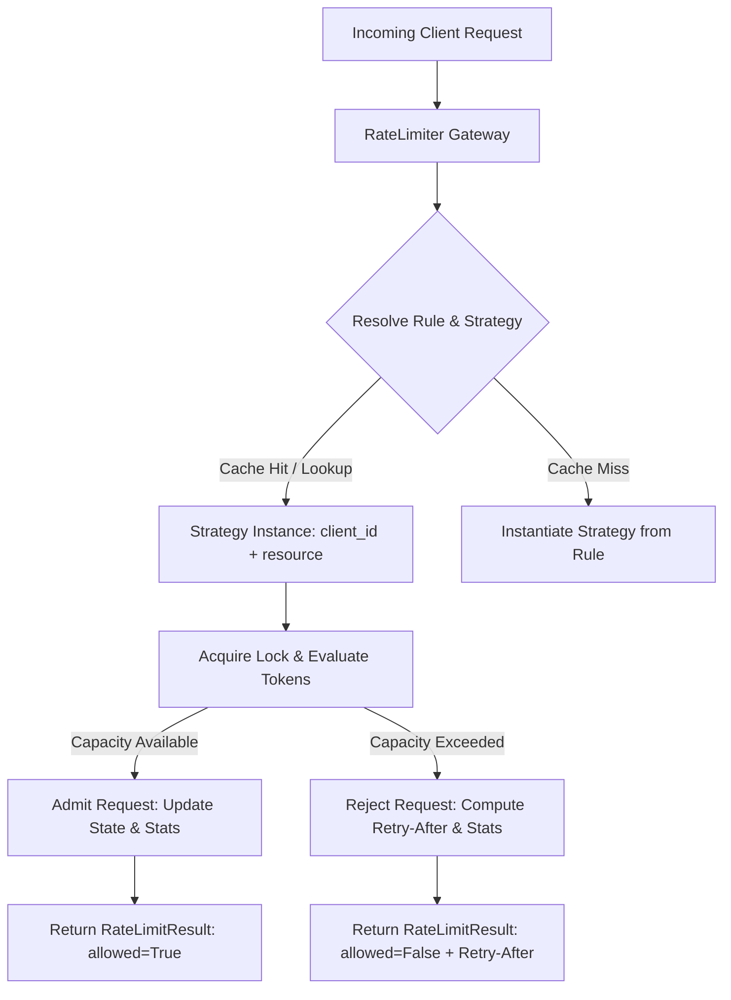

# Project 1: LLM API Gateway Rate Limiter

> **Difficulty:** Easy | **Category:** System Design, Concurrency, API Design | **Target Interview Time:** 45 mins

---

## 1. Problem Statement & Context

In a modern AI / LLM gateway architecture (e.g., LiteLLM, Cloudflare AI Gateway, Kong), multiple client applications share scarce downstream LLM inference resources (e.g., token quotas, TPM/RPM limits on OpenAI/Anthropic). 

The rate limiter must:
1. Prevent any single tenant from monopolizing gateway capacity while guaranteeing multi-tenant state isolation.
2. Provide two configurable algorithms:
   - **Sliding Window Log**: For strict non-burst limits (e.g. max 60 requests per minute without window boundary exploits).
   - **Token Bucket**: For burst-tolerant workloads with continuous token replenishment.
3. Compute exact **remaining capacity** and **estimated recovery time (`Retry-After`)** for client backoff.
4. Maintain thread-safe statistics across all requests.
5. Guarantee zero race conditions under high concurrent request volume.

---

## 2. Architecture & Design



### Key Architectural Layers
1. **`models.py`**: Immutable configuration (`RateLimitConfig`), admission response (`RateLimitResult`), and mutable stats (`RateLimiterStats`).
2. **`strategies/`**: 
   - `SlidingWindowStrategy`: Deque of `(timestamp, token_count)` maintaining sliding history.
   - `TokenBucketStrategy`: Continuous mathematical refill based on delta time $\Delta t$.
3. **`limiter.py`**: Central coordinator managing tenant-isolated strategy instances, hierarchical configuration lookup, and defensive copy state delivery.

---

## 3. Algorithm Deep-Dive & Mathematical Formulation

### 3.1 Sliding Window Log
- **Mechanism**: Stores timestamps of accepted requests in a double-ended queue (`collections.deque`).
- **Eviction**: At evaluation time $t$, evict all entries where:
  $$\text{timestamp} \le t - \text{windowSeconds}$$
- **Admission**: If $\sum \text{tokens} + \text{requested} \le \text{capacity}$, admit.
- **Retry-After Calculation**: To admit a new request of size $R$, the system needs to shed $\text{deficit} = \text{current} + R - \text{capacity}$ tokens. We iterate through the oldest entries in the deque until the accumulated shed count $\ge \text{deficit}$. The time when that entry expires is $t_{\text{expire}} = t_{\text{entry}} + \text{window}$, giving:
  $$\text{RetryAfter} = \max(0, t_{\text{expire}} - t)$$

### 3.2 Token Bucket
- **Mechanism**: Maintains a float `tokens` and `last_refill_time`. Instead of running an active background timer thread, refill is computed lazily upon each request:
  $$\Delta t = t - \text{lastRefillTime}$$
  $$\text{tokens} = \min(\text{capacity}, \text{tokens} + \Delta t \times \text{refillRate})$$
- **Admission**: If $\text{tokens} \ge \text{requested}$, deduct tokens and allow.
- **Retry-After Calculation**:
  $$\text{RetryAfter} = \frac{\text{requested} - \text{tokens}}{\text{refillRate}}$$

---

## 4. Concurrency & Thread-Safety Model

1. **Two-Level Locking Hierarchy**:
   - **Master Lock (`self._master_lock`)**: Protects the registry of tenant strategy instances and global statistics counters.
   - **Per-Strategy Lock (`self._lock` inside each strategy instance)**: Protects individual bucket mutations. This prevents requests for `Tenant A` from blocking concurrent requests for `Tenant B`.
2. **Snapshot Isolation & Defensive Copying**:
   - `get_stats()` returns a `copy.deepcopy()` to ensure external callers cannot mutate internal monitoring state.

---

## 5. Complexity Analysis

| Strategy | Time Complexity (Per Request) | Space Complexity |
|---|---|---|
| **Sliding Window** | $O(K)$ where $K$ is number of expired events to evict | $O(N)$ where $N$ is number of requests in current window |
| **Token Bucket** | $O(1)$ constant time arithmetic | $O(1)$ constant state (2 floats) |

---

## 6. Interview Talking Points & Follow-Ups

- **Q: Why Token Bucket over Sliding Window for LLMs?**
  *Answer:* LLMs experience bursty workloads (e.g. generating multiple prompt queries) and token counts vary widely. Token Bucket naturally supports burst capacity up to the bucket ceiling and constant $O(1)$ evaluation time, whereas Sliding Window Log memory grows linearly with request volume.
- **Q: How would you scale this to a distributed cluster?**
  *Answer:* In a distributed system, local in-memory instances lead to inconsistent quota enforcement. We would back this with Redis using Lua scripts for atomicity (e.g., executing the token refill and deduction in a single Redis script) or use Redis Cell. To avoid Redis bottlenecks at scale, we can use local batching with periodic asynchronous synchronization.
- **Q: How do you prevent thundering herds when the rate limit window resets?**
  *Answer:* Return randomized jitter alongside `Retry-After` (e.g., Full Jitter or Equal Jitter) so clients do not all retry simultaneously at the exact second of expiration.

---

## 7. Verification & Testing

Execute the full suite of unit and multi-threaded stress tests:

```bash
python -m pytest Proj_1/tests -v
```

Expected output: 12 tests passed covering boundary cases, burst refills, multi-tenant isolation, and concurrent contention.
