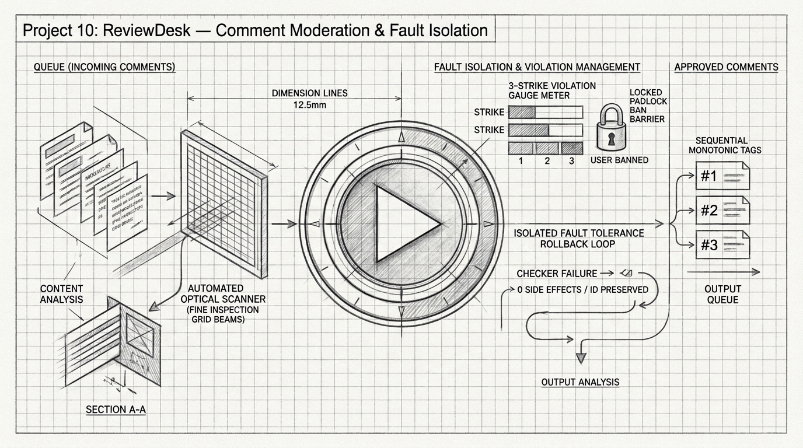
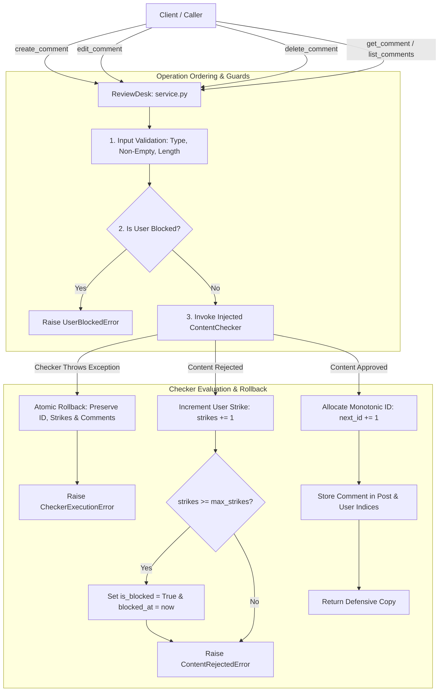
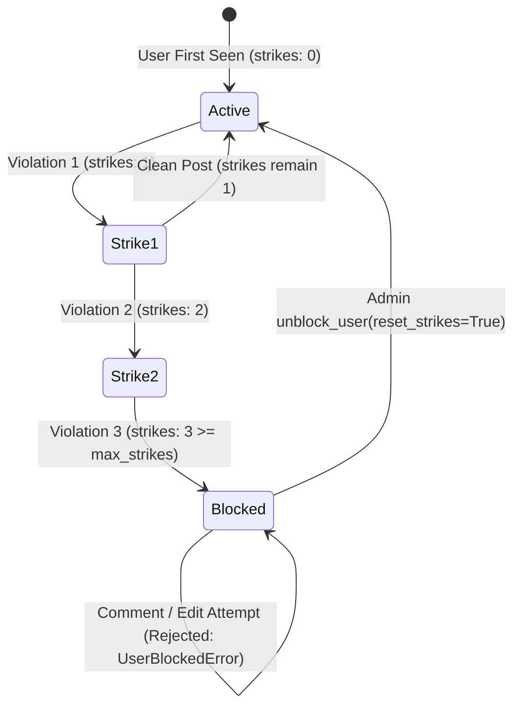

# Project 10: ReviewDesk — In-Memory Comment Moderation Service

> **Difficulty:** Medium | **Category:** State Management, Fault Isolation, Input Validation, Concurrency | **Target Interview Time:** 60 mins

---

## 🎥 Video Walkthrough & Deep Dive (NotebookLM)

> [!TIP]
> **Conceptual Overview & Architecture Breakdown:**  
> A complete visual and audio explanation covering ReviewDesk's injected content moderation architecture, strict operation ordering, failure isolation with atomic rollback, persistent strike state machines, automated blocking thresholds, resource authorization, and defensive snapshot isolation.

<div align="center">

[](https://drive.google.com/file/d/1XEIIKV9zv6iWv-eYu1K8vHfpT6bwCO8E/view?usp=sharing)

[](https://drive.google.com/file/d/1XEIIKV9zv6iWv-eYu1K8vHfpT6bwCO8E/view?usp=sharing)

</div>

---

## 1. Problem Statement & Engineering Context

In content-driven platforms (e.g., Reddit, YouTube comments, Substack, Medium), user-generated content must undergo automated and policy-based moderation to filter hate speech, spam, phishing, and malware. 

ReviewDesk is an in-memory comment and moderation management service backed by an injected external content checker. It enforces seven foundational engineering constraints:

1. **Injected Moderation & Failure Isolation**:
   - Content checks are performed via an injected `ContentChecker` protocol.
   - If the external content checker crashes (e.g., network timeout, socket reset, 500 internal server error), the service **must abort cleanly without side effects**:
     - No comment ID is consumed or allocated (next successful comment receives the exact sequential ID).
     - No violation strikes are levied against the user.
     - In-memory comment stores and post streams remain completely unmodified.
2. **Operation Ordering**:
   - Pre-validation $\to$ User block status check $\to$ External checker moderation $\to$ Strike accumulation / auto-blocking on rejection $\to$ Monotonic ID allocation and storage on approval.
3. **Persistent Violation State & Auto-Blocking**:
   - Tracks strikes across writes per user.
   - When a user's strike count reaches a configurable threshold (`max_strikes = 3`), the user is immediately transitioned to `is_blocked = True`.
   - Blocked users are barred from both creating new comments and editing existing comments.
4. **Resource Ownership & Authorization**:
   - Only the original author can edit or delete their comment. Unauthorized attempts raise `UnauthorizedError`.
5. **Defensive Copy Snapshotting**:
   - All query operations (`get_comment`, `list_comments`, `get_user_state`) return deep defensive copies to prevent caller mutations from polluting internal state.
6. **Concurrency & Thread Safety**:
   - Guaranteed atomic state updates, gapless sequential ID allocation, and race-free strike transitions under heavy multi-threaded workloads.

---

## 2. System Architecture & State Machine



### User Violation State Machine



---

## 3. Step-by-Step Execution Walkthrough (With Real Figures)

### 3.1 External Checker Failure Isolation (Atomic Rollback)

> **Scenario:** Service starts with `next_comment_id = 1`. Comment 1 succeeds. Comment 2 encounters a checker network timeout. Comment 3 succeeds.

| Step | Caller Action | Checker Execution | Service Internal State | ID Allocated | Strike Impact | Outcome |
|:---:|---|---|---|:---:|:---:|---|
| **1** | Alice posts: `"Great article!"` | Approved | `comments: {1: Comment_1}`<br>`next_comment_id: 2` | **`1`** | Alice: `0` strikes | **Success** (Comment #1 created) |
| **2** | Bob posts: `"Hello team"` | **Raises `TimeoutError`** | `comments: {1: Comment_1}`<br>`next_comment_id: 2` | **None** | Bob: `0` strikes | **Failure Isolated** (`CheckerExecutionError`). ID counter not touched; no strikes added. |
| **3** | Charlie posts: `"Second post"` | Approved | `comments: {1: Comment_1, 2: Comment_2}`<br>`next_comment_id: 3` | **`2`** | Charlie: `0` strikes | **Success** (Comment #2 created). **Zero ID gaps!** |

---

### 3.2 Progressive Strike Accumulation & Automatic User Banning

> **Configuration:** `max_strikes = 3`. User `spammer_dave` attempts a sequence of actions over time.

| Time ($t$) | Action / Submitted Payload | Moderation Decision | User State (`strikes`, `is_blocked`) | Response / Exception | System Impact |
|---|---|:---:|:---:|---|---|
| **$t = 0\text{s}$** | `create_comment("Visit phishing.com")` | **REJECTED** | `strikes: 1, is_blocked: False` | `ContentRejectedError` | Strike 1 recorded. Comment dropped. |
| **$t = 5\text{s}$** | `create_comment("Legitimate discussion")` | **APPROVED** | `strikes: 1, is_blocked: False` | `Comment(id=1, ...)` | Comment #1 published. Strike 1 persists. |
| **$t = 12\text{s}$** | `create_comment("Buy cheap crypto scam")` | **REJECTED** | `strikes: 2, is_blocked: False` | `ContentRejectedError` | Strike 2 recorded. Comment dropped. |
| **$t = 20\text{s}$** | `create_comment("Malware download link")` | **REJECTED** | `strikes: 3, is_blocked: True` | `ContentRejectedError` | **Threshold reached!** User auto-blocked at $t=20\text{s}$. |
| **$t = 25\text{s}$** | `create_comment("I apologize, let me post")` | *Pre-empted* | `strikes: 3, is_blocked: True` | `UserBlockedError` | **Blocked immediately**. External checker never called. |
| **$t = 30\text{s}$** | `edit_comment(1, "Updated text")` | *Pre-empted* | `strikes: 3, is_blocked: True` | `UserBlockedError` | Blocked user barred from editing existing comments. |
| **$t = 60\text{s}$** | Admin: `unblock_user("spammer_dave")` | *Administrative* | `strikes: 0, is_blocked: False` | `UserState(is_blocked=False)` | User restored to clean standing. |

---

### 3.3 Concurrent Monotonic ID Allocation

> **Scenario:** 30 worker threads simultaneously create comments for various posts.

| Thread Pool Execution | Lock Acquisition | Next ID Counter Read | Memory Persistence | Output ID |
|:---:|:---:|:---:|:---:|:---:|
| Worker 1 | Acquired `RLock` | `self._next_comment_id = 1` | Stored in `self._comments[1]` | `1` |
| Worker 2 | Acquired `RLock` | `self._next_comment_id = 2` | Stored in `self._comments[2]` | `2` |
| $\dots$ | $\dots$ | $\dots$ | $\dots$ | $\dots$ |
| Worker 30 | Acquired `RLock` | `self._next_comment_id = 30` | Stored in `self._comments[30]` | `30` |

- **Verification:** Resulting IDs are strictly unique, monotonic, and span $\{1, 2, \dots, 30\}$ with zero missing elements and zero duplicates.

---

### 3.4 Resource Ownership & Authorization Verification

> **Scenario:** User `user_alice` authored comment #42. User `user_mallory` attempts to mutate it.

```
user_alice ───────── create_comment(#42) ─────────> ReviewDesk (author: user_alice)
                                                            ▲
user_mallory ─────── edit_comment(#42, "malicious") ───────┤ [Ownership Guard]
                                                            │ Check: comment.user_id == user_mallory
                                                            ▼
                                                    UnauthorizedError!
```

- **Invariant:** A user can only edit or delete comments where `comment.user_id == caller_user_id`. Attempting to modify another user's comment raises `UnauthorizedError` before any moderation checker is invoked.

---

## 4. Algorithmic Complexity & Mathematical Modeling

### 4.1 State Transition Formulation

Let $S_u(t) \in \mathbb{N}_0$ represent the strike count of user $u$ at time $t$, and $B_u(t) \in \{0, 1\}$ represent their blocking status.
Given strike threshold $\theta = \text{max\_strikes}$:

$$S_u(t+1) = \begin{cases} S_u(t) + 1 & \text{if moderation fails} \\ S_u(t) & \text{if moderation succeeds or checker crashes} \end{cases}$$

$$B_u(t+1) = \begin{cases} 1 & \text{if } S_u(t+1) \ge \theta \\ B_u(t) & \text{otherwise} \end{cases}$$

### 4.2 Time & Space Complexity

| Operation | Time Complexity | Space Complexity | Notes |
|---|:---:|:---:|---|
| `create_comment` | $O(M + R)$ | $O(M)$ | $M$ is content length, $R$ is regex check cost; $O(1)$ dictionary insertion. |
| `edit_comment` | $O(M + R)$ | $O(M)$ | Lookups and updates are $O(1)$ under lock. |
| `get_comment` | $O(M)$ | $O(M)$ | $O(1)$ dictionary lookup + defensive copy of size $M$. |
| `list_comments` | $O(K \cdot M)$ | $O(K \cdot M)$ | $K$ is the number of comments on the target post. |
| `delete_comment` | $O(K)$ | $O(1)$ | $O(1)$ dict deletion + $O(K)$ index list removal. |
| `get_user_state` | $O(1)$ | $O(1)$ | $O(1)$ point lookup and frozen dataclass construction. |

---

## 5. Verification & Automated Test Suite

ReviewDesk is validated by **28 automated pytest test cases** covering every failure mode, concurrency condition, and lifecycle scenario:

```bash
# Run ReviewDesk test suite
python -m pytest Proj_10/tests/ -v
```

### Test Suite Directory Structure

- [`test_moderation_checker_failure_isolation.py`](./tests/test_moderation_checker_failure_isolation.py):
  - Injected checker exceptions (`TimeoutError`, `RuntimeError`) do not consume comment IDs.
  - Checker failures do not increment strike counts.
  - Content edit failures preserve previous comment text.
  - Invalid checker return types raise `CheckerExecutionError` cleanly.
- [`test_moderation_concurrency.py`](./tests/test_moderation_concurrency.py):
  - 30 concurrent comment creators get unique monotonic sequential IDs without gaps.
  - 20 concurrent violations on one user atomically increment strikes to exactly 3 and block all remaining requests.
  - 15 concurrent edits on a single comment execute with consistent snapshot isolation.
- [`test_moderation_strikes_and_blocking.py`](./tests/test_moderation_strikes_and_blocking.py):
  - Strike accumulation and persistence across successful comments.
  - Auto-blocking at threshold with timestamp assignment.
  - Blocked users prevented from editing earlier comments.
  - Administrative unblock and strike resets.
- [`test_moderation_lifecycle.py`](./tests/test_moderation_lifecycle.py):
  - Create, get, edit, list by post, list by user, delete.
- [`test_moderation_ownership_and_auth.py`](./tests/test_moderation_ownership_and_auth.py):
  - Unauthorized edits and deletions raise `UnauthorizedError`.
  - Non-existent comment queries raise `CommentNotFoundError`.
- [`test_moderation_input_validation.py`](./tests/test_moderation_input_validation.py):
  - Empty strings, whitespace-only strings, nulls, oversized content ($\gt 5000$ chars), and non-positive IDs.
- [`test_moderation_defensive_copies.py`](./tests/test_moderation_defensive_copies.py):
  - Mutating retrieved comment or user state objects does not mutate internal service state.

---

## 6. Practical Interview Tradeoffs & System Design Talking Points

When presenting this design in a senior engineering interview:

1. **Synchronous vs. Asynchronous Moderation**:
   - *Synchronous (ReviewDesk)*: Ensures violating content never touches public feeds. Best for high-risk text (hate speech, payment phishing) where zero-tolerance display is required.
   - *Asynchronous (Event-Driven via Kafka)*: High-throughput platforms (Twitter/X, YouTube) publish comments optimistically and dispatch moderation jobs to workers via message queues. If flagged asynchronously, the comment is tombstoned/shadow-banned.
2. **Failure Isolation Strategy**:
   - In microservice ecosystems, the content checker is often an external ML model or 3rd-party vendor (e.g. OpenAI Moderation API, AWS Rekognition).
   - If the downstream checker is down or times out, should the platform **Fail Open** (allow comment through, queue for later review) or **Fail Closed** (abort creation, notify user)? ReviewDesk demonstrates strict **Fail-Closed Isolation**, preventing unmoderated content while ensuring the user is never unfairly penalized with violation strikes.
3. **Circuit Breakers**:
   - In production, wrap external checker calls in a Circuit Breaker (Netflix Hystrix / Resilience4j pattern). If consecutive checker calls fail $\gt 50\%$ over a 10s rolling window, trip the circuit to avoid cascading thread starvation.
