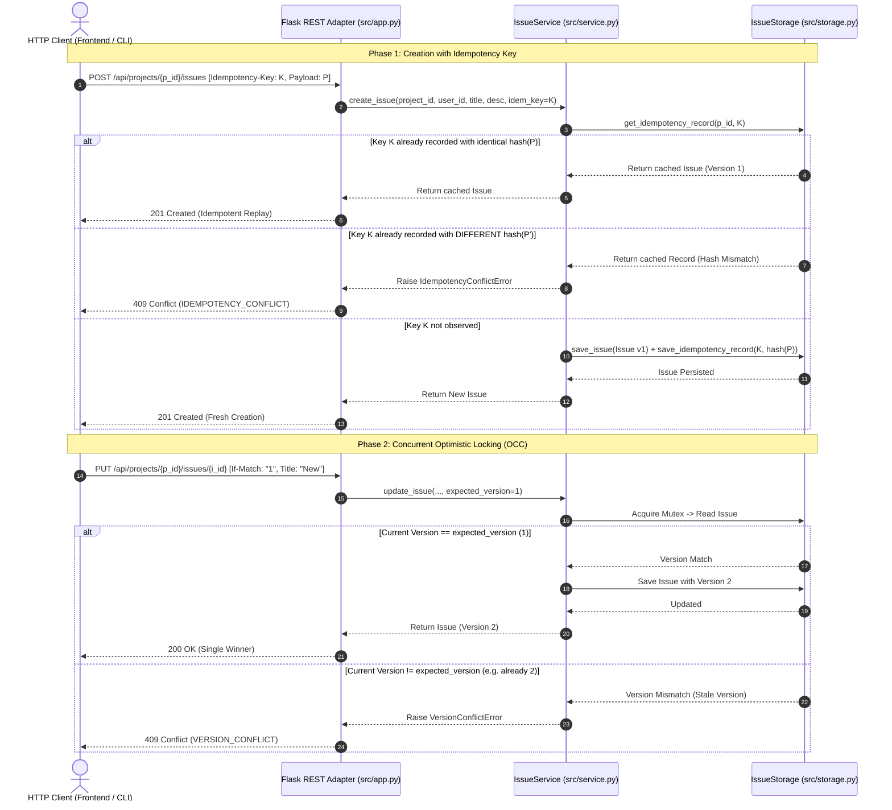
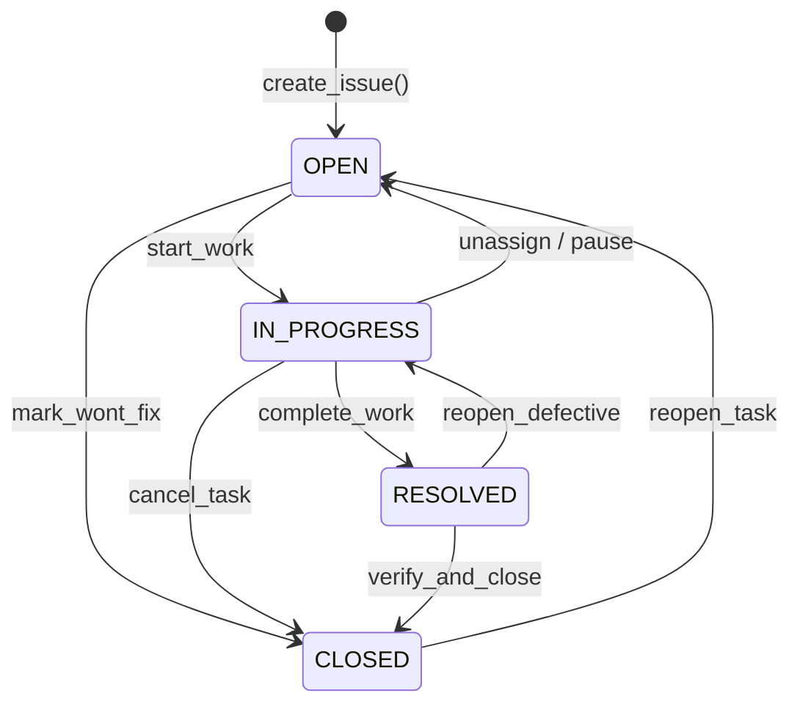

# Project 11: IssueHub — Retry-Safe Issue Service

> **Difficulty:** Hard | **Category:** Distributed Systems, Idempotency, Concurrency Control, Optimistic Locking, Cursor Pagination | **Target Interview Time:** 75 mins

---

## 🎥 Video Walkthrough & Deep Dive (NotebookLM)

> [!TIP]
> **Conceptual Overview & Architecture Breakdown:**  
> A complete visual and audio deep dive covering IssueHub's distributed engineering architecture: SHA-256 payload-hashed idempotency keys, single-winner optimistic concurrency control (OCC) with monotonically incrementing version checks, strict role-based project isolation, finite state machine status workflows, and tamper-resistant cursor-based pagination.

<div align="center">

*Video walkthrough link and architectural blueprint thumbnail will be available shortly.*

</div>

---

## 1. Problem Statement & Engineering Context

In enterprise issue tracking and project collaboration platforms (e.g., Jira, Linear, GitHub Issues, Asana), thousands of distributed team members create, update, and triage tasks concurrently across flakey cellular or enterprise networks.

Building an issue management service at scale introduces five critical distributed systems challenges:
1. **Network Retries & Duplicate Creation:** Due to mobile packet drops or gateway timeouts (HTTP 504), clients retry creation requests. Without distributed idempotency, retried network requests create duplicate ghost tickets.
2. **The Lost Update Anomaly under Concurrency:** When two team members open the same ticket simultaneously and submit edits, the last write silently overwrites earlier modifications unless coordinated by optimistic concurrency control (OCC).
3. **Mismatched Idempotency Key Reuse:** If an upstream client reuses an idempotency key with different payload parameters, the system must detect the conflict and abort rather than returning inaccurate cached data.
4. **Finite State Machine (FSM) Integrity:** Issues must progress through deterministic lifecycle stages (`OPEN -> IN_PROGRESS -> RESOLVED -> CLOSED`). Illegal leaps (e.g. jumping from `OPEN` straight to `RESOLVED`) must be intercepted and rejected.
5. **Cursor Stability under Continuous Write Traffic:** Traditional `OFFSET / LIMIT` database pagination skips or duplicates items when new records are inserted during browsing. The listing API must enforce stable cursor-based navigation.
6. **Multi-Tenant Project Authorization:** Data and member privileges must remain strictly isolated across project boundaries. Viewers must not mutate tickets, and non-members must receive zero information leakage.

IssueHub provides a production-grade, thread-safe implementation that resolves all five concurrency and distributed systems requirements with mathematical rigor.

---

## 2. System Architecture & Concurrency Model

### 2.1 Idempotency Key Evaluation & OCC Lifecycle



### 2.2 Issue Status Finite State Machine (FSM)



---

## 3. Discrete Mathematical Modeling & Invariants

Let the issue tracking universe at discrete time $t$ be formalized by the state tuple:

$$
\mathcal{S}_t = \langle \mathcal{P}, \mathcal{M}_t, \mathcal{I}_t, \mathcal{K}_t \rangle
$$

Where:
- $\mathcal{P}$ is the set of all registered projects.
- $\mathcal{M}_t: \mathcal{P} \times \text{User} \to \{\text{ADMIN}, \text{MEMBER}, \text{VIEWER}\}$ maps project memberships.
- $\mathcal{I}_t: \mathcal{P} \times \text{IssueId} \to \text{Issue}$ is the active issue storage mapping.
- $\mathcal{K}_t: \mathcal{P} \times \text{IdemKey} \to \langle \text{hash}, \text{Issue} \rangle$ is the idempotency cache.

### 3.1 Idempotency Safety Invariant
For an incoming creation request $\mathbf{req} = \langle p, u, T, D, A \rangle$ with idempotency key $k \in \text{IdemKey}$, let the normalized payload hash be:

$$
\mathcal{H}(\mathbf{req}) = \text{SHA256}(\text{json-canonical}(T, D, A))
$$

The transition function $\mathcal{T}_{\text{create}}(\mathcal{S}_t, k, \mathbf{req})$ satisfies:

$$
\mathcal{T}_{\text{create}}(k, \mathbf{req}) = \begin{cases}
\mathcal{K}_t(p, k).\text{response} & \text{if } (p, k) \in \mathcal{K}_t \land \mathcal{K}_t(p, k).\text{hash} = \mathcal{H}(\mathbf{req}) \\
\text{Conflict}(409) & \text{if } (p, k) \in \mathcal{K}_t \land \mathcal{K}_t(p, k).\text{hash} \ne \mathcal{H}(\mathbf{req}) \\
\text{Issue}(v=1) & \text{if } (p, k) \notin \mathcal{K}_t
\end{cases}
$$

### 3.2 Optimistic Concurrency Control (OCC) Invariant
Let an issue $i \in \mathcal{I}_t$ possess monotonically increasing version $v(i) \in \mathbb{Z}^+$. For an update or transition operation specifying expected version $v_{\text{exp}}$:

$$
v(i_{t+1}) = \begin{cases}
v(i_t) + 1 & \text{if } v_{\text{exp}} = v(i_t) \\
\text{Aborted}(409\text{ Version Conflict}) & \text{if } v_{\text{exp}} \ne v(i_t)
\end{cases}
$$

$$
\forall t_1 < t_2, \quad v(i_{t_1}) < v(i_{t_2})
$$

Under $N$ simultaneous concurrent update attempts against version $v$, exactly $\min(1, N) = 1$ request succeeds and $N - 1$ requests are safely rejected.

### 3.3 Stable Cursor Pagination Ordering
Let issues be totally ordered by the strict lexicographical tuple:

$$
i_1 \prec i_2 \iff (i_1.\text{created-at} < i_2.\text{created-at}) \lor (i_1.\text{created-at} = i_2.\text{created-at} \land i_1.\text{id} < i_2.\text{id})
$$

Given a cursor $C = \text{Base64}(t_{\text{prev}}, \text{id}_{\text{prev}})$, the filtered query window evaluates:

$$
\text{Page}(C, L) = \text{Take}\left(\{ i \in \mathcal{I}_t(p) \mid i \succ \langle t_{\text{prev}}, \text{id}_{\text{prev}} \rangle \}, \; L \right)
$$

This guarantees zero element repetition and zero element skipping across consecutive page fetches even under concurrent append operations.

---

## 4. Step-by-Step Chronological Walkthrough (Real Figures)

| Step | Operation Executed | Actor / Role | Parameters & Payload | Evaluated Decision Path | Resulting State | Status Code / Invariant |
|:---:|---|---|---|---|:---:|:---:|
| **0** | `create_project` | Alice (Owner) | `project_id="proj_backend"`, `name="Backend Core"` | Project initialized; Alice assigned `ADMIN` | Project active | **201 Created** |
| **1** | `add_member` | Alice (Admin) | `user_id="bob"`, `role="MEMBER"` | Admin authorization verified; Bob enrolled | Bob is `MEMBER` | **200 OK** |
| **2** | `add_member` | Alice (Admin) | `user_id="charlie"`, `role="VIEWER"` | Charlie enrolled with read-only access | Charlie is `VIEWER` | **200 OK** |
| **3** | `create_issue` | Bob (Member) | `title="Fix Race"`, `Idempotency-Key="k_101"` | Member check passed; key `k_101` recorded | `issue_id="iss_1"`, `v=1` | **201 Created** |
| **4** | `create_issue` (Retry) | Bob (Member) | Identical payload, `Idempotency-Key="k_101"` | Hash matched; returns cached response | `issue_id="iss_1"`, `v=1` | **201 Created** (Idempotent) |
| **5** | `create_issue` (Mismatch) | Bob (Member) | Different title `"Altered"`, `Key="k_101"` | Key exists but hash differs! | State untouched | **409 Conflict** (`IDEMPOTENCY_CONFLICT`) |
| **6** | `update_issue` (Race) | 25 Threads | Competing updates with `expected_version=1` | Thread 7 acquires lock first ($1 \to 2$); remaining 24 see version mismatch | `v=2` | **1 Winner (200)**, **24 Conflicts (409)** |
| **7** | `transition_status` | Charlie (Viewer)| Transition `OPEN -> IN_PROGRESS` | Charlie is VIEWER; lacks mutation rights | State untouched | **403 Forbidden** (`AUTHORIZATION_ERROR`) |
| **8** | `transition_status` | Bob (Member) | Transition `OPEN -> RESOLVED` | Illegal leap (violates FSM sequence) | State untouched | **409 Conflict** (`INVALID_TRANSITION`) |
| **9** | `transition_status` | Bob (Member) | Transition `OPEN -> IN_PROGRESS`, `ver=2` | Valid FSM step; version increments | Status `IN_PROGRESS`, `v=3` | **200 OK** |
| **10**| `list_issues` | Charlie (Viewer)| `limit=10`, `cursor=None` | Viewer permitted; yields first 10 items | `has_more=True` | **200 OK** |

---

## 5. REST API Specification

The service provides a production Flask REST adapter ([`src/app.py`](./src/app.py)):

| HTTP Method | Route | Required Headers | Request Body | Success Code | Error Codes | Description |
|---|---|---|---|:---:|:---:|---|
| `POST` | `/api/projects` | `X-User-ID` | `{"project_id": "p1", "name": "Core"}` | `201 Created` | `400, 409` | Registers a new project and sets caller as ADMIN. |
| `GET` | `/api/projects/<id>` | `X-User-ID` | *None* | `200 OK` | `403, 404` | Retrieves project metadata. |
| `POST` | `/api/projects/<id>/members` | `X-User-ID` | `{"user_id": "u2", "role": "MEMBER"}` | `200 OK` | `400, 403, 404` | Adds or updates a project member's role. |
| `POST` | `/api/projects/<id>/issues` | `X-User-ID`, `Idempotency-Key` (Opt) | `{"title": "...", "description": "..."}` | `201 Created` | `400, 403, 404, 409` | Creates issue with retry-safe idempotency. |
| `GET` | `/api/projects/<id>/issues/<i_id>` | `X-User-ID` | *None* | `200 OK` | `403, 404` | Retrieves issue snapshot. |
| `PUT` | `/api/projects/<id>/issues/<i_id>` | `X-User-ID`, `If-Match` (Opt) | `{"expected_version": 1, "title": "..."}` | `200 OK` | `400, 403, 404, 409` | Updates issue fields with OCC version validation. |
| `POST` | `/api/projects/<id>/issues/<i_id>/transition` | `X-User-ID` | `{"expected_version": 2, "new_status": "..."}` | `200 OK` | `400, 403, 404, 409` | Advances issue status across permitted transitions. |
| `GET` | `/api/projects/<id>/issues` | `X-User-ID` | Query params: `status`, `limit`, `cursor` | `200 OK` | `400, 403, 404` | Retrieves paginated issue list with cursor seek. |

---

## 6. Complexity Analysis

| Operation | Method Signature | Time Complexity | Auxiliary Space Complexity | Algorithmic Mechanism |
|---|---|:---:|:---:|---|
| **Create Project** | `create_project(...)` | $O(1)$ | $O(1)$ | Hash table registration and role assignment. |
| **Create Issue** | `create_issue(...)` | $O(L)$ | $O(L)$ | SHA-256 payload hash of size $L$ + dictionary insertion. |
| **Get Issue** | `get_issue(...)` | $O(1)$ | $O(1)$ | Direct dictionary lookup by `(project_id, issue_id)`. |
| **Update Issue (OCC)** | `update_issue(...)` | $O(1)$ | $O(1)$ | In-memory atomic version comparison and state copy. |
| **Status Transition** | `transition_status(...)` | $O(1)$ | $O(1)$ | Set membership check in `VALID_TRANSITIONS` + version increment. |
| **Cursor Pagination** | `list_issues(...)` | $O(K + \text{limit})$ | $O(\text{limit})$ | Binary search / scan over ordered index of $K$ issues. |

---

## 7. Practical Interview Talking Points & System Design Deep Dives

1. **Why Payload Hashing with Idempotency Keys?**
   - Naive systems only store `idempotency_key -> response`. If a buggy client reuses the same key for completely different transactions (e.g. creating Bug A, then reusing the key for Bug B), returning the previous ticket results in severe data corruption. Hashing the canonical request parameters (`SHA256(canonical_json)`) detects parameter divergence immediately and yields an explicit `409 Conflict`.
2. **Optimistic Concurrency Control (OCC) vs. Pessimistic Locking:**
   - In web environments where team members keep edit screens open for minutes or hours, pessimistic locks (`SELECT ... FOR UPDATE`) hold database resources idle, cause deadlocks, and block reads. OCC (using an integer `version` or `ETag`) allows unlimited parallel reads and defers conflict resolution to the point of write, achieving maximum throughput.
3. **Cursor-Based Pagination vs. Offset Pagination:**
   - With `OFFSET 10000`, the database must read and discard 10,000 rows, creating $O(N)$ query degradation. More dangerously, if an issue is created while a client browses page 1, reading page 2 with `OFFSET 10` returns the 10th item from page 1 again (off-by-one duplicate). Cursor pagination uses lexicographical tuple seeking `(created_at, issue_id) > (cursor_t, cursor_id)`, providing $O(\log N)$ seeks and 100% stable traversal.

---

## 8. Verification & Automated Test Suite

IssueHub is validated by **28 automated pytest test cases** spanning project authorization, idempotency replay, optimistic locking, high-contention multi-threaded updates, finite state machine transitions, and cursor pagination:

```bash
# Execute Proj_11 test suite (28 passing tests)
python -m pytest Proj_11/tests/ -v

# Execute entire workspace test suite (266 passing tests)
python -m pytest -v
```

### Test Suite Directory Breakdown

- [`test_issue_lifecycle.py`](./tests/test_issue_lifecycle.py):
  - **Happy Path Lifecycle:** Validates project creation, issue initialization at version 1, and immutable timestamp tracking.
  - **Field Mutations:** Proves updating title, description, and assignee cleanly increments version $v \to v+1$.
  - **Full FSM Progression:** Validates complete valid lifecycle progression (`OPEN -> IN_PROGRESS -> RESOLVED -> CLOSED -> OPEN`).
  - **Illegal Transition Interception:** Proves illegal status jumps (`OPEN -> RESOLVED`) are intercepted and rejected with `InvalidStatusTransitionError`.

- [`test_idempotency_and_retry_safety.py`](./tests/test_idempotency_and_retry_safety.py):
  - **Idempotent Replay:** Proves identical creation retries return the exact same issue snapshot without duplicate creation.
  - **Payload Mismatch Conflict:** Validates that reusing an idempotency key with altered parameters raises `IdempotencyConflictError` (HTTP 409).
  - **Multi-Project Scope:** Proves identical idempotency keys used across distinct projects operate independently without collision.
  - **Failed Request Recovery:** Asserts that a failed request (e.g. validation failure) does not poison the idempotency key, allowing subsequent valid attempts to succeed.

- [`test_optimistic_locking_and_concurrency.py`](./tests/test_optimistic_locking_and_concurrency.py):
  - **Stale Version Rejection:** Proves updates providing an outdated version are rejected with `VersionConflictError`.
  - **25-Thread Concurrent Update Race:** 25 concurrent worker threads all attempting to update the same issue with `expected_version = 1`; proves exactly 1 winner succeeds (advances to version 2) and 24 receive version conflict.
  - **Concurrent Status Transition Race:** 20 concurrent threads attempting status transitions; verifies strict single-winner resolution.

- [`test_cursor_pagination.py`](./tests/test_cursor_pagination.py):
  - **Multi-Page Traversal:** Seeds 25 issues and paginates with limit 10; asserts Page 1 (10 items), Page 2 (10 items), Page 3 (5 items), with zero duplicate or skipped records.
  - **Status Filtering:** Verifies cursor pagination accurately filters by status across pages.
  - **Boundary Limits:** Validates enforcement of limits ($1 \le \text{limit} \le 100$) and rejection of invalid/corrupted cursor strings.

- [`test_authorization_and_project_isolation.py`](./tests/test_authorization_and_project_isolation.py):
  - **Role Hierarchy Enforcement:** Proves viewers are strictly prohibited from creating, updating, or transitioning issues, while permitted to read and list.
  - **Non-Member Rejection:** Proves non-members attempting access receive `AuthorizationError`.
  - **Cross-Project Isolation:** Proves users cannot read or mutate issues belonging to projects they do not belong to.

- [`test_validation_and_defensive_copies.py`](./tests/test_validation_and_defensive_copies.py):
  - **Boolean Trap Protection:** Explicitly tests and rejects boolean values (`True`/`False`) passed for `expected_version`, `limit`, or string fields.
  - **Whitespace & Empty Field Validation:** Proves empty strings are rejected.
  - **Issue Immutability:** Proves frozen dataclass entities prevent external callers from mutating internal state.

- [`test_issue_flask_api.py`](./tests/test_issue_flask_api.py):
  - **HTTP Adapter Verification:** Tests REST routes, `X-User-ID`, `Idempotency-Key`, and `If-Match` header integration.
  - **Status Code Mapping:** Validates HTTP `200 OK`, `201 Created`, `400 Bad Request`, `403 Forbidden`, `404 Not Found`, and `409 Conflict`.
