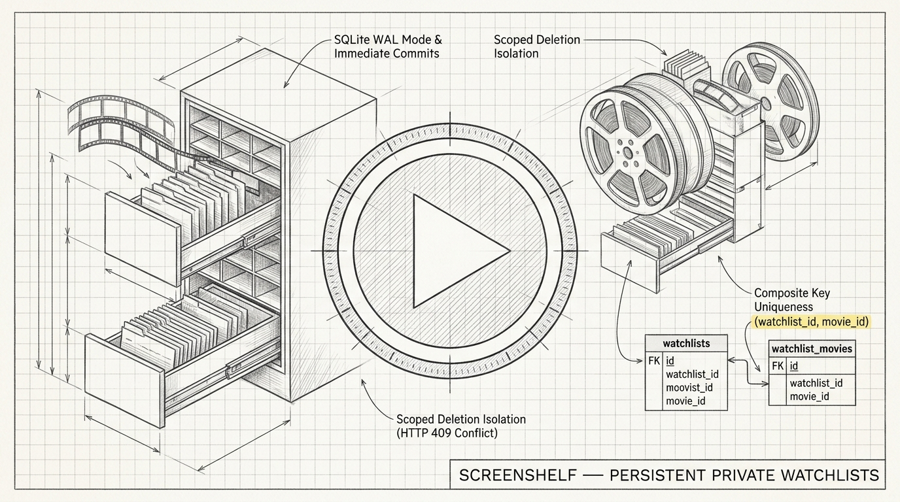
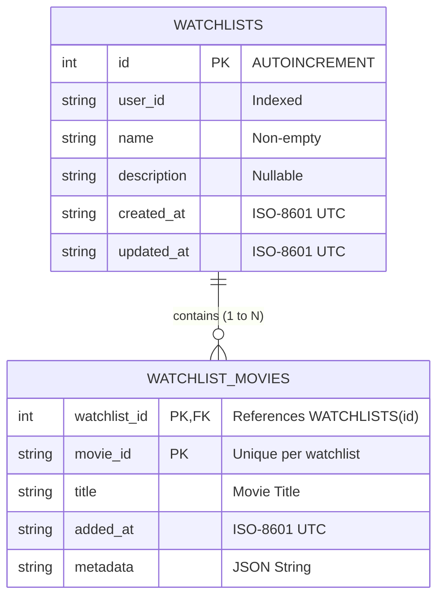
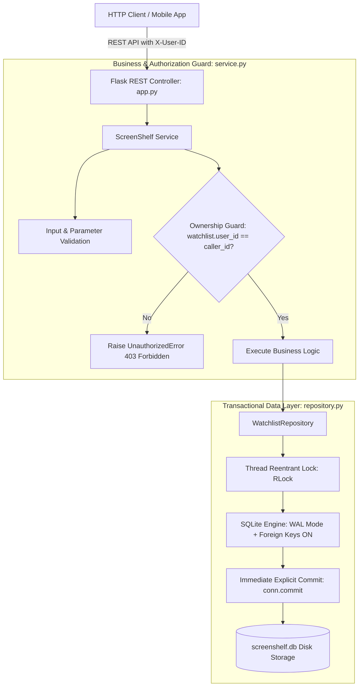

# Project 14: ScreenShelf — Persistent Private Watchlists

> **Difficulty:** Medium | **Category:** SQLite Persistence, Transactions, Authorization, Concurrency, CRUD | **Target Interview Time:** 60 mins

---

## 🎥 Video Walkthrough & Deep Dive (NotebookLM)

> [!TIP]
> **Conceptual Overview & Architecture Breakdown:**  
> A complete visual and audio explanation covering ScreenShelf's relational data model, composite key constraints, debugging cross-watchlist deletion bugs, WAL mode persistence, multi-instance transactional commits, private ownership authorization, and Flask REST routing.

<div align="center">

[](https://drive.google.com/file/d/1EzjQ8Nak1oAkPVF_XPLWWIhkascuK10I/view?usp=sharing)

[](https://drive.google.com/file/d/1EzjQ8Nak1oAkPVF_XPLWWIhkascuK10I/view?usp=sharing)

</div>

---

## 1. Problem Statement & Engineering Context

Media tracking platforms (e.g., Letterboxd, IMDb, Netflix My List) allow users to curate private collections of movies and shows. In practical backend engineering interviews, candidates are often evaluated not on building greenfield toys, but on **diagnosing and repairing subtle data corruption and transaction bugs in legacy code**.

ScreenShelf is a SQLite-backed watchlist management service that suffered from three critical production defects in its legacy implementation:
1. **Ambiguous Statuses on Duplicate Additions**: Adding a movie already present in a watchlist crashed with unhandled database errors or returned misleading success codes instead of an explicit conflict.
2. **Cross-Watchlist Movie Removal Bug**: Removing a movie from one watchlist unintentionally removed it from *every* watchlist across the platform.
3. **Lost Committed State on Reconnect / Multi-Instance Desynchronization**: Modifications made by one service instance were invisible to secondary instances or vanished after connection restarts due to missing explicit transaction commits.

This project delivers a repaired, thread-safe, and fully tested reference implementation featuring private user ownership, strict composite membership isolation, atomic commits, and a Flask REST API.

---

## 2. Relational Architecture & Entity Relationships



### System Component Architecture



---

## 3. Root Cause Analysis & Step-by-Step State Timelines

### 3.1 Bug Fix 1: Cross-Watchlist Movie Removal Anomaly

> **Defect Analysis**: The legacy implementation executed `DELETE FROM watchlist_movies WHERE movie_id = ?`. Because it failed to scope by `watchlist_id`, removing `"m_interstellar"` from Watchlist #1 stripped it from Watchlist #2 as well!
>
> **Repaired Execution**:
> ```sql
> DELETE FROM watchlist_movies
> WHERE watchlist_id = ? AND movie_id = ?;
> ```

#### Real-Figure State Timeline

| Step | Caller Action | Target Watchlist | SQL Query Executed | Watchlist #1 State | Watchlist #2 State | Result |
|:---:|---|:---:|---|---|---|---|
| **1** | Alice creates List 1 (`"Sci-Fi"`) | #1 | `INSERT INTO watchlists ...` | `movies: []` | *N/A* | Created |
| **2** | Alice creates List 2 (`"Favorites"`) | #2 | `INSERT INTO watchlists ...` | `movies: []` | `movies: []` | Created |
| **3** | Add `"m_interstellar"` to List 1 | #1 | `INSERT INTO watchlist_movies (1, 'm_interstellar', ...)` | `['m_interstellar']` | `[]` | Added |
| **4** | Add `"m_interstellar"` to List 2 | #2 | `INSERT INTO watchlist_movies (2, 'm_interstellar', ...)` | `['m_interstellar']` | `['m_interstellar']` | Added |
| **5** | **Remove `"m_interstellar"` from List 1** | **#1** | `DELETE FROM watchlist_movies WHERE watchlist_id = 1 AND movie_id = 'm_interstellar'` | **`[]`** *(Removed)* | **`['m_interstellar']`** *(Preserved!)* | **Isolated Success** |

---

### 3.2 Bug Fix 2: Duplicate Movie Handling & Status Integrity

> **Defect Analysis**: Adding a movie twice previously crashed with an unhandled database exception or silently overwritten timestamps.
>
> **Repaired Execution**: ScreenShelf enforces `PRIMARY KEY (watchlist_id, movie_id)`. Adding a duplicate catches the database constraint violation and raises `DuplicateMovieError` mapping to **HTTP 409 Conflict**.

#### Concurrency Stress Trace: 15 Simultaneous Duplicate Additions

| Thread Group | Submitted Payload | SQLite Transaction | Lock Resolution | HTTP Status | Response Payload |
|:---:|---|---|:---:|:---:|---|
| **Thread 1** *(Winner)* | `movie_id: "m_oppenheimer"` | `INSERT INTO watchlist_movies ...` | Committed | **`201 Created`** | `{"movie_id": "m_oppenheimer", ...}` |
| **Threads 2–15** *(Losers)* | `movie_id: "m_oppenheimer"` | `INSERT` raises `IntegrityError` | Caught & Handled | **`409 Conflict`** | `{"error": "Movie 'm_oppenheimer' already exists in watchlist #1"}` |

- **Verification Result**: Exactly **1 winner**, exactly **14 conflict rejections**. Movie appears exactly once in the watchlist.

---

### 3.3 Bug Fix 3: Multi-Instance Persistence & Reconnect Loss

> **Defect Analysis**: Without explicit transaction commits, SQLite leaves write transactions in memory or journal files. When secondary service instances read the database, uncommitted writes are invisible.
>
> **Repaired Execution**: Enforced `PRAGMA journal_mode = WAL;` and explicit `self._conn.commit()` at the termination of every mutating method.

```
Process A (Instance 1) ──── create_watchlist(#10) ────> [conn.commit()] ───┐
                                                                           │ (screenshelf.db)
Process B (Instance 2) ──── get_watchlist(#10) <──── [Reads Committed] ───┘
```

#### Real-Figure Multi-Instance Verification

| Time ($t$) | Process / Instance | Action | Database Execution | Observed State in Instance 1 | Observed State in Instance 2 |
|---|---|---|---|:---:|:---:|
| **$t = 0\text{ms}$** | Instance 1 | `create_watchlist("Classics")` | `INSERT ...; COMMIT;` | `id: 1, name: "Classics"` | *Not queried yet* |
| **$t = 5\text{ms}$** | Instance 1 | `add_movie(1, "m_godfather")` | `INSERT ...; COMMIT;` | `movies: ["m_godfather"]` | *Not queried yet* |
| **$t = 10\text{ms}$** | **Instance 2** *(Fresh Connect)* | `get_watchlist(1)` | `SELECT ...` | `movies: ["m_godfather"]` | **`movies: ["m_godfather"]`** |
| **$t = 15\text{ms}$** | Instance 2 | `rename_watchlist(1, "All-Time Best")` | `UPDATE ...; COMMIT;` | *Pending poll* | `name: "All-Time Best"` |
| **$t = 20\text{ms}$** | Instance 1 | `get_watchlist(1)` | `SELECT ...` | **`name: "All-Time Best"`** | `name: "All-Time Best"` |
| **$t = 25\text{ms}$** | Instance 1 | `close()` | `conn.close()` | *Terminated* | *Active* |
| **$t = 30\text{ms}$** | Instance 2 | `get_watchlist_movies(1)` | `SELECT ...` | *Terminated* | **Data 100% Intact** |

---

### 3.4 Private Ownership & Authorization Matrix

Watchlists are private to their creator. Operations from foreign users are rejected with **HTTP 403 Forbidden** before any database mutation occurs.

| Endpoint | Operation | Alice (Owner: `user_alice`) | Bob (Caller: `user_bob`) | Unauthenticated (No `X-User-ID`) |
|---|---|:---:|:---:|:---:|
| `GET /api/watchlists` | List collections | **`200 OK`** (Alice's lists) | **`200 OK`** (Bob's lists) | **`401 Unauthorized`** |
| `GET /api/watchlists/1` | Read watchlist | **`200 OK`** | **`403 Forbidden`** | **`401 Unauthorized`** |
| `PATCH /api/watchlists/1` | Rename | **`200 OK`** | **`403 Forbidden`** | **`401 Unauthorized`** |
| `POST /api/watchlists/1/movies` | Add movie | **`201 Created`** | **`403 Forbidden`** | **`401 Unauthorized`** |
| `DELETE /api/watchlists/1/movies/m1` | Remove movie | **`200 OK`** | **`403 Forbidden`** | **`401 Unauthorized`** |
| `DELETE /api/watchlists/1` | Delete collection | **`200 OK`** | **`403 Forbidden`** | **`401 Unauthorized`** |

---

## 4. Mathematical & Relational Modeling

### 4.1 Composite Set Uniqueness

Let $\mathcal{W}$ be the set of watchlists and $\mathcal{M}$ be the universe of movies. The membership relation is defined as:
$$\mathcal{R} \subseteq \mathcal{W} \times \mathcal{M}$$

For any watchlist $w \in \mathcal{W}$, its movie set is given by:
$$M(w) = \{ m \in \mathcal{M} \mid (w, m) \in \mathcal{R} \}$$

The database constraint guarantees that:
$$\forall (w, m) \in \mathcal{R}, \quad \text{count}(w, m) = 1$$

Therefore, adding movie $m$ to watchlist $w$ is defined by the transition:
$$M'(w) = \begin{cases} M(w) \cup \{m\} & \text{if } m \notin M(w) \\ \text{Error}(409\text{ Conflict}) & \text{if } m \in M(w) \end{cases}$$

And removing movie $m$ from watchlist $w_1$ satisfies the strict independence condition:
$$M'(w_1) = M(w_1) \setminus \{m\}, \quad \text{while } \forall w_2 \ne w_1, \quad M'(w_2) = M(w_2)$$

### 4.2 Time & Space Complexity

| Operation | Time Complexity | Disk I/O Operations | Space Complexity |
|---|:---:|:---:|:---:|
| `create_watchlist` | $O(1)$ | 1 Write (Append WAL) | $O(1)$ |
| `get_watchlist` | $O(K)$ | 2 Reads (`watchlists` + `watchlist_movies`) | $O(K)$ |
| `list_watchlists` | $O(W \cdot K)$ | 1 Read + $W$ junction queries | $O(W \cdot K)$ |
| `rename_watchlist` | $O(1)$ | 1 Write (Indexed update) | $O(1)$ |
| `delete_watchlist` | $O(K)$ | 2 Writes (Cascade delete) | $O(1)$ |
| `add_movie` | $O(1)$ | 1 Write (PK index insert) | $O(1)$ |
| `remove_movie` | $O(1)$ | 1 Write (PK index delete) | $O(1)$ |

*Note: $W$ represents user watchlist count; $K$ represents movie count in the target watchlist.*

---

## 5. REST API Specifications & HTTP Status Codes

| Endpoint | Method | Required Headers | Request Payload | Success Status | Error Responses |
|---|:---:|---|---|:---:|:---:|
| `/api/watchlists` | `POST` | `X-User-ID` | `{"name": str, "description"?: str}` | `201 Created` | `400 Bad Request`<br>`401 Unauthorized` |
| `/api/watchlists` | `GET` | `X-User-ID` | *None* | `200 OK` | `401 Unauthorized` |
| `/api/watchlists/<id>` | `GET` | `X-User-ID` | *None* | `200 OK` | `401 Unauthorized`<br>`403 Forbidden`<br>`404 Not Found` |
| `/api/watchlists/<id>` | `PATCH` | `X-User-ID` | `{"name": str}` | `200 OK` | `400 Bad Request`<br>`403 Forbidden`<br>`404 Not Found` |
| `/api/watchlists/<id>` | `DELETE` | `X-User-ID` | *None* | `200 OK` | `401 Unauthorized`<br>`403 Forbidden`<br>`404 Not Found` |
| `/api/watchlists/<id>/movies` | `POST` | `X-User-ID` | `{"movie_id": str, "title": str, "metadata"?: dict}` | `201 Created` | `400 Bad Request`<br>`403 Forbidden`<br>`404 Not Found`<br>`409 Conflict` |
| `/api/watchlists/<id>/movies/<movie_id>` | `DELETE` | `X-User-ID` | *None* | `200 OK` | `401 Unauthorized`<br>`403 Forbidden`<br>`404 Not Found` |

---

## 6. Verification & Automated Test Suite

ScreenShelf is validated by **23 automated pytest test cases** spanning persistence, concurrency, and API contracts:

```bash
# Run ScreenShelf test suite
python -m pytest Proj_14/tests/ -v
```

### Test Suite Directory Structure

- [`test_movie_membership_and_isolation.py`](file:///C:/Devfield/leet_project/Proj_14/tests/test_movie_membership_and_isolation.py):
  - Proves removing a movie from Watchlist A leaves Watchlist B unaffected.
  - Verifies movie metadata retention (`genre`, `year`, `director`).
  - Verifies `MovieNotFoundError` when removing a non-existent movie.
- [`test_duplicate_movie_handling.py`](file:///C:/Devfield/leet_project/Proj_14/tests/test_duplicate_movie_handling.py):
  - Verifies `DuplicateMovieError` (HTTP 409) on duplicate movie additions.
  - Verifies the same movie can exist in distinct watchlists.
- [`test_multi_instance_persistence.py`](file:///C:/Devfield/leet_project/Proj_14/tests/test_multi_instance_persistence.py):
  - Multi-instance concurrent read-write verification on real disk SQLite databases.
  - Data integrity verification across complete service shutdown and restart cycles.
- [`test_ownership_and_authorization.py`](file:///C:/Devfield/leet_project/Proj_14/tests/test_ownership_and_authorization.py):
  - Strict private watchlist security: verifies `UnauthorizedError` (HTTP 403) across all endpoints.
- [`test_watchlist_concurrency.py`](file:///C:/Devfield/leet_project/Proj_14/tests/test_watchlist_concurrency.py):
  - 20 concurrent threads adding distinct movies without deadlocks.
  - 15 concurrent threads racing to add the same movie (1 winner, 14 conflicts).
- [`test_flask_api_endpoints.py`](file:///C:/Devfield/leet_project/Proj_14/tests/test_flask_api_endpoints.py):
  - Complete HTTP contract verification: 201, 200, 401, 403, 404, 409.
- [`test_watchlist_lifecycle.py`](file:///C:/Devfield/leet_project/Proj_14/tests/test_watchlist_lifecycle.py):
  - Full CRUD lifecycle, renaming, and cascading deletion.

---

## 7. Practical Interview Tradeoffs & System Design Talking Points

When presenting ScreenShelf in a senior engineering interview:

1. **Junction Table vs. Embedded Document Array**:
   - *Document Stores (MongoDB)*: Storing movie IDs inside an array `watchlist.movies = ["m1", "m2"]` offers fast single-document reads. However, arrays suffer from document size limits (16MB), lack referential integrity, and require complex `$addToSet` operations for uniqueness.
   - *Relational Junction Table (ScreenShelf)*: A normalized `watchlist_movies` table scales indefinitely, enables foreign key cascading on delete, and enforces strict uniqueness via composite primary keys `PRIMARY KEY (watchlist_id, movie_id)`.
2. **SQLite WAL Mode vs. Traditional Rollback Journal**:
   - In traditional journal mode, readers block writers and writers block readers.
   - In **WAL (Write-Ahead Logging)** mode (`PRAGMA journal_mode = WAL;`), readers never block writers, and writers never block readers. This enables high-concurrency read-heavy workloads (typical for watchlist browsing) while maintaining atomic write transactions.
3. **Optimistic Concurrency vs. Database Mutexing**:
   - SQLite enforces single-writer serialization at the file level. For distributed scale (e.g. hundreds of web workers), migrate to PostgreSQL with connection pooling (PgBouncer) and row-level locks (`SELECT ... FOR UPDATE`).
