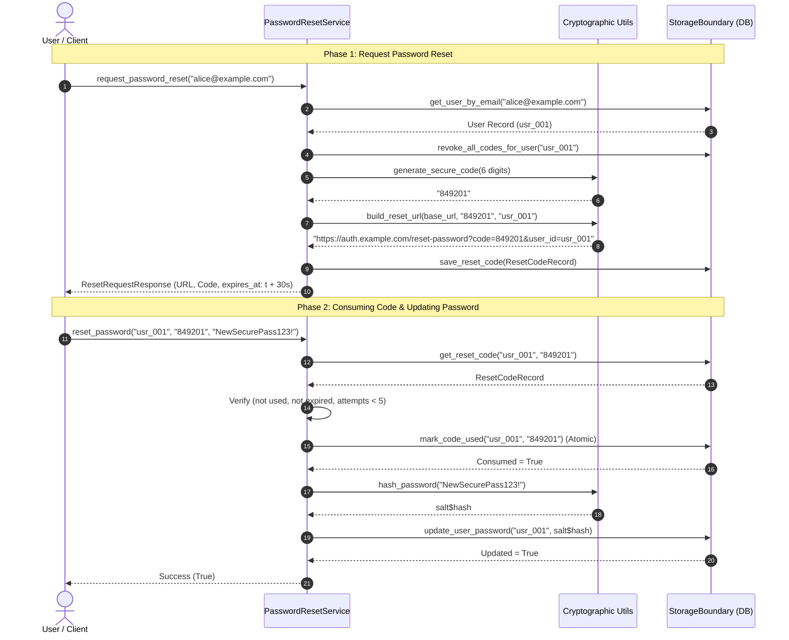

# Project 15: Password Reset Workflow & Security Lifecycle

> **Difficulty:** Easy | **Category:** Security, Datetime Handling, State Persistence | **Target Interview Time:** 45 mins

---

## 1. Problem Statement & Incident Background

In production identity services (e.g., Auth0, Firebase Auth, Okta), the password recovery workflow is one of the highest-value security surfaces. A vulnerable or buggy recovery service leads directly to account takeovers and system lockouts.

This project investigates and resolves five critical defects present in a legacy authentication service:
1. **Broken Auth URL Generation**: Naive string concatenation resulted in double slashes (`//reset-password`), dropped query parameters, and malformed redirect routes.
2. **Naive vs. Timezone-Aware DateTime Crashes**: The legacy service mixed offset-naive system datetimes with timezone-aware ISO timestamps, causing Python `TypeError` exceptions or incorrect expiration evaluations across daylight saving and server timezone boundaries.
3. **Flawed Expiration Calculation**: Tokens failed to enforce the strict 30-second security window.
4. **Token Replay Vulnerability**: Used reset codes could be submitted multiple times before expiration, leaving windows open for man-in-the-middle or race replay exploits.
5. **Storage Boundary Leaks**: Password state mutations were lost across service reconnects or corrupted due to exposed mutable internal references.

---

## 2. System Architecture & Recovery Lifecycle



---

## 3. Step-by-Step Execution Walkthrough (With Real Figures)

### 3.1 Happy Path & Exact 30-Second Validity Window

> **Configuration:** `expiration_seconds = 30.0s`, `code_length = 6`.

| Time ($t$) | Action | Input / Event | Stored Expiration Time | Status | Detailed Explanation |
|---|---|---|---|:---:|---|
| **$12:00:00.000$** | Reset Requested | Email: `alice@example.com` | `12:00:30.000 UTC` | **Code Issued** | Prior active codes for `alice` are revoked. Code `849201` is generated. |
| **$12:00:15.000$** | Validation Check | Code: `849201` | `12:00:30.000 UTC` | **Allowed** | $\Delta t = 15.0\text{s} \le 30.0\text{s}$. Code is active and unconsumed. |
| **$12:00:30.000$** | Exact Boundary | Code: `849201` | `12:00:30.000 UTC` | **Allowed** | $\Delta t = 30.0\text{s} = 30.0\text{s}$. Exactly on the 30-second deadline. |
| **$12:00:30.100$** | Post-Deadline Attempt | Code: `849201` | `12:00:30.000 UTC` | **Rejected (`ExpiredCodeError`)** | $\Delta t = 30.1\text{s} > 30.0\text{s}$. Request rejected; password remains unchanged. |

---

### 3.2 Replay Attack Prevention (Atomic One-Time Consumption)

> **Scenario:** Attacker intercepts code `849201` or client attempts concurrent replay within the 30-second window.

| Time ($t$) | Requesting Actor | Operation | Code State in DB | Outcome | Security Invariant |
|---|---|---|:---:|:---:|---|
| **$12:00:10.000$** | Legitimate User | `reset_password(..., "NewPassA!")` | `is_used = False` | **Success (`True`)** | Code is atomically flipped to `is_used = True`. DB password hash updated. |
| **$12:00:10.050$** | Replay / Race Thread | `reset_password(..., "HackedPassB!")` | `is_used = True` | **Rejected (`CodeAlreadyUsedError`)** | Atomicity check prevents overwriting password. |
| **$12:00:12.000$** | Subsequent Validation | `validate_reset_code(...)` | `is_used = True` | **Rejected (`CodeAlreadyUsedError`)** | Code cannot be validated or reused ever again. |

---

### 3.3 Subsequent Request Revocation (Superseding Codes)

> **Scenario:** User requests a password reset code, doesn't see the email immediately, and clicks "Send Code Again" 5 seconds later.

| Time ($t$) | Action | Code Generated | Code 1 Status | Code 2 Status | Outcome |
|---|---|:---:|:---:|:---:|---|
| **$12:00:00$** | Request 1 | `111222` | Active (`is_used = False`) | — | Code 1 valid until `12:00:30`. |
| **$12:00:05$** | Request 2 | `999888` | **Revoked (`is_used = True`)** | Active (`is_used = False`) | Request 2 invalidates Code 1 immediately. Code 2 valid until `12:00:35`. |
| **$12:00:10$** | Submit Code 1 | `111222` | Revoked | Active | **Rejected (`CodeAlreadyUsedError`)**. Prevents out-of-order email delivery bugs. |
| **$12:00:12$** | Submit Code 2 | `999888` | Revoked | Consumed | **Success (`True`)**. Password updated. |

---

### 3.4 DateTime Normalization & Timezone Handling

To prevent `TypeError: can't compare offset-naive and offset-aware datetimes` and regional offset skew:

| Input Datetime Type | Raw Value | Normalization Rule | Standardized Output (UTC) |
|---|---|---|---|
| **Aware UTC** | `2026-10-20 12:00:00+00:00` | Preserve UTC timestamp | `2026-10-20 12:00:00+00:00` |
| **Aware Offset (IST: +05:30)** | `2026-10-20 17:30:00+05:30` | `dt.astimezone(timezone.utc)` | `2026-10-20 12:00:00+00:00` |
| **Aware Offset (PST: -08:00)** | `2026-10-20 04:00:00-08:00` | `dt.astimezone(timezone.utc)` | `2026-10-20 12:00:00+00:00` |
| **Legacy Naive (No tzinfo)** | `2026-10-20 12:00:00` | `dt.replace(tzinfo=timezone.utc)` | `2026-10-20 12:00:00+00:00` |

---

## 4. Key Engineering & Security Decisions

### 4.1 Cryptographic Randomness vs. Standard PRNG
- **Anti-Pattern:** `random.randint(100000, 999999)`. Standard Mersenne Twister PRNGs are deterministic; an attacker who observes 624 generated codes can predict all future reset tokens.
- **Production Standard:** `secrets.choice("0123456789")` backed by the operating system's CSPRNG (`/dev/urandom` or Windows `CryptGenRandom`).

### 4.2 Safe Salted Password Hashing
- **Algorithm:** PBKDF2-HMAC-SHA256 with a unique 16-byte cryptographically random salt per user and 100,000 iterations.
- **Verification:** Evaluated using `secrets.compare_digest()` to eliminate timing attack side-channels.

### 4.3 Atomic Single-Use Token Consumption
- Under high concurrency, two requests submitting the same valid code simultaneously could both pass validation before either updates the database.
- **Resolution:** `mark_code_used()` performs an atomic check-and-set transition inside a thread-safe critical section (`threading.RLock`), guaranteeing that exactly **1 thread succeeds** while all competing threads receive `CodeAlreadyUsedError`.

---

## 5. Complexity Analysis

| Operation | Time Complexity | Space Complexity | Explanation |
|---|:---:|:---:|---|
| `request_password_reset` | $O(K)$ | $O(1)$ | $K$ is number of prior codes for user (typically $\le 3$) to revoke. Code generation and URL building are $O(1)$. |
| `validate_reset_code` | $O(K)$ | $O(1)$ | Lookup in user reset history and constant-time datetime comparison. |
| `reset_password` | $O(P)$ | $O(1)$ | $P$ is the PBKDF2 hash computation work factor (100,000 iterations), CPU-bound by design. |

---

## 6. Interview Talking Points & Follow-Ups

- **Q: How would you scale this to multiple distributed backend instances?**  
  *Answer:* The in-memory storage boundary is replaced with Redis or PostgreSQL. In Redis, token issuance and revocation uses a key structure `reset_code:{user_id}` with a native Redis TTL (`SET reset_code:{user_id} {code} EX 30`). Atomic single-use consumption is executed via a Lua script (`GET` + `DEL`) or Redis transaction (`WATCH` / `MULTI`), ensuring only one consumer can claim the token.
- **Q: How do you protect against brute-force attacks on 6-digit codes?**  
  *Answer:* With a 30-second window, $10^6$ combinations cannot be easily brute-forced if we enforce a maximum failed attempts cap (default: 5 failed attempts locks the token immediately via `RateLimitExceededError`) along with IP-level rate limiting from Project 01.
- **Q: What if the client device's clock is out of sync with the server?**  
  *Answer:* Expiration must **always** be calculated and validated relative to server-side clocks, never client-reported timestamps. When the client initiates the request, the server records `created_at = server_now()` and `expires_at = created_at + 30s`. Subsequent validations compare only against `server_now()`.

---

## 7. Verification & Testing

Execute the full suite of unit, security, and multi-threaded race condition tests:

```bash
python -m pytest Proj_15/tests -v
```

Expected output: 21 tests passed covering configuration loading, datetime normalization, exact window thresholds, replay attack defense, and concurrent consumption locks.
